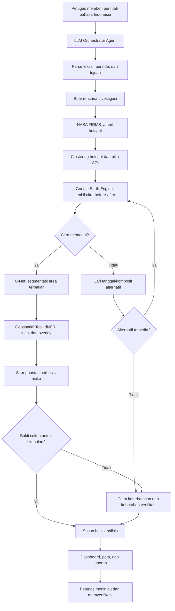

# Rancangan Fitur dan Workflow Agentic AI — Agen Karhutla

> **Konsep produk:** *Autonomous Wildfire Investigation & Response Prioritization*  
> **Target pengguna:** BPBD, Manggala Agni, Kesatuan Pengelolaan Hutan (KPH), dan tim analis kebakaran hutan dan lahan.  
> **Tujuan utama:** Mempercepat pemeriksaan indikasi karhutla, memetakan wilayah yang diduga terbakar, menganalisis dampak, dan membantu menentukan prioritas verifikasi maupun patroli.

---

## 1. Ringkasan Konsep

**Agen Karhutla** adalah platform *AI-powered wildfire monitoring and decision support* yang dirancang untuk mengintegrasikan data titik panas (*hotspot*), citra satelit, model segmentasi area terbakar, analisis spasial, dan pembuatan laporan dalam satu alur kerja.

Permasalahan yang ingin dijawab adalah lamanya proses mengumpulkan serta menafsirkan informasi dari berbagai sumber untuk mengetahui lokasi yang diduga mengalami kebakaran, estimasi luasnya, dan area mana yang sebaiknya diperiksa lebih dahulu.

Perbedaan utama Agen Karhutla dengan dashboard pemantauan biasa adalah penggunaan **Agentic AI**. Sistem tidak hanya menampilkan data atau menjalankan urutan proses yang tetap, tetapi dapat:

1. Memahami perintah pengguna dalam bahasa Indonesia.
2. Menyusun rencana investigasi sesuai tujuan.
3. Memilih dan memanggil tool yang relevan.
4. Mengevaluasi kualitas hasil dan ketersediaan bukti.
5. Mencoba strategi alternatif apabila terdapat hambatan, misalnya citra tertutup awan.
6. Menyusun hasil analisis beserta alasan, sumber, dan ketidakpastian untuk ditinjau petugas.

**Contoh perintah pengguna:**

> “Analisis potensi kebakaran di Pulang Pisau selama tujuh hari terakhir, hitung perkiraan area terdampak, dan prioritaskan lokasi yang dekat permukiman atau berada di lahan gambut.”

**Batasan penting:** titik panas merupakan indikasi anomali termal, bukan konfirmasi kebakaran; estimasi area terbakar dari model adalah hasil prediksi yang perlu divalidasi; dan sistem mendukung, bukan menggantikan, keputusan operasional petugas.

---

## 2. Rangkaian Fitur Utama

### 2.1 AI Command Center — Natural Language Assistant

**Deskripsi:** Antarmuka percakapan yang memungkinkan petugas menjalankan investigasi menggunakan bahasa Indonesia, tanpa harus menulis kode atau menguasai perangkat lunak penginderaan jauh.

**Contoh perintah:**

- “Analisis potensi kebakaran di Pulang Pisau selama tujuh hari terakhir.”
- “Tampilkan area gambut yang memiliki klaster hotspot.”
- “Cari area terbakar di Kalimantan Tengah pada September 2019.”
- “Bandingkan kondisi citra sebelum dan sesudah dugaan kebakaran.”

**Peran Agentic AI:**

- Mengekstraksi lokasi, rentang waktu, tujuan analisis, dan batasan permintaan.
- Membuat *execution plan* atau rencana investigasi.
- Memilih tool berdasarkan kebutuhan.
- Menggabungkan keluaran berbagai tool menjadi penjelasan yang koheren.
- Meminta klarifikasi hanya jika parameter penting tidak dapat ditentukan secara aman.

**Output:** respons percakapan, rencana kerja, status proses, dan tautan ke hasil investigasi.

### 2.2 Intelligent Hotspot Detection & Clustering

**Deskripsi:** Mengambil data titik panas dari **NASA FIRMS**, lalu mengolahnya menjadi kumpulan kandidat lokasi yang perlu ditelusuri lebih lanjut.

**Proses:**

1. Mengambil data hotspot berdasarkan batas wilayah dan periode.
2. Membaca atribut seperti koordinat, waktu deteksi, sumber sensor, dan informasi pendukung yang tersedia.
3. Mengelompokkan hotspot berdekatan menggunakan aturan spasial yang terdokumentasi.
4. Mengidentifikasi pola kemunculan berulang serta klaster dengan konsentrasi tinggi.
5. Menghasilkan daftar kandidat area yang akan diperiksa menggunakan citra satelit.

**Peran Agentic AI:** menentukan wilayah/periode pengambilan data, memutuskan klaster mana yang memerlukan analisis lanjutan, dan menjelaskan alasan pemilihannya.

**Output:** peta sebaran hotspot, klaster hotspot, dan daftar kandidat investigasi.

> **Catatan:** jumlah hotspot tidak sama dengan jumlah kejadian kebakaran. Sistem harus memisahkan label *terdeteksi sebagai hotspot* dari *terkonfirmasi terbakar*.

### 2.3 Autonomous Satellite Image Retrieval

**Deskripsi:** Mencari dan memproses citra satelit sebelum serta sesudah dugaan kejadian melalui **Google Earth Engine**.

**Proses:**

1. Membentuk area pengamatan (*area of interest* / AOI) dari klaster atau lokasi pilihan pengguna.
2. Mencari citra **Landsat 8/9** pada rentang waktu yang relevan.
3. Menyaring citra berdasarkan cakupan lokasi dan kualitas data.
4. Menghasilkan pasangan atau komposit citra *before–after*.
5. Memeriksa area yang tertutup awan, bayangan awan, atau data tidak valid.

**Peran Agentic AI:** memilih kandidat citra dan memutuskan kapan perlu menggunakan tanggal alternatif atau komposit lain.

**Output:** citra sebelum–sesudah, metadata sensor/tanggal, cakupan pengamatan, dan indikator kualitas.

> **Catatan historis:** untuk studi kejadian tahun 2019, gunakan Landsat 8 dan/atau Sentinel-2; Landsat 9 belum tersedia pada tahun tersebut.

### 2.4 Automated Burned Area Segmentation

**Deskripsi:** Mendeteksi area yang diduga terbakar dari citra menggunakan model segmentasi **U-Net**.

**Proses:**

1. Menyiapkan input citra sesuai band, resolusi, dan normalisasi yang dipakai model.
2. Menjalankan inferensi U-Net pada area pengamatan.
3. Menghasilkan *segmentation mask* untuk piksel yang diprediksi sebagai area terbakar.
4. Mengubah mask menjadi poligon geografis apabila dibutuhkan.
5. Menghitung estimasi luas area berdasarkan geometri serta resolusi yang benar.

**Peran Agentic AI:** memanggil tool inferensi, memeriksa keberhasilan proses, dan menentukan tindak lanjut saat keluaran model tidak memadai.

**Output:** mask/poligon area diduga terbakar, perkiraan luas dalam hektare, dan informasi kualitas prediksi.

> **Catatan validasi:** kualitas model tidak boleh disimpulkan hanya dari visual peta. Gunakan metrik segmentasi pada data uji yang dipisahkan secara benar.

### 2.5 Fire Severity Analysis

**Deskripsi:** Mengukur perubahan karakteristik spektral lahan sebelum–sesudah kejadian menggunakan **difference Normalized Burn Ratio (dNBR)**.

Rumus:

$$
dNBR = NBR_{\text{sebelum}} - NBR_{\text{sesudah}}
$$

**Proses:**

1. Menghitung NBR pada citra sebelum dan sesudah kejadian.
2. Menghasilkan raster dNBR.
3. Memadukan hasil dNBR dengan area yang tersegmentasi oleh U-Net.
4. Menghitung statistik nilai dan luas per kelas dampak.
5. Menampilkan klasifikasi tingkat keparahan setelah ambang batasnya ditentukan secara tepat.

**Peran Agentic AI:** mengatur eksekusi perhitungan dan menginterpretasikan hasil secara hati-hati berdasarkan kualitas sumber data.

**Output:** peta dNBR, ringkasan nilai, serta kelas dampak seperti rendah, sedang, dan tinggi jika sudah dikalibrasi.

> **Catatan:** ambang dNBR tidak boleh diperlakukan sebagai standar universal tanpa memeriksa kesesuaian ekosistem dan kondisi lokal.

### 2.6 Risk-Based Patrol Prioritization

**Deskripsi:** Menggabungkan bukti kebakaran dan faktor risiko spasial untuk menyusun kandidat lokasi patroli atau pemeriksaan lapangan.

**Faktor yang dapat digunakan:**

- Keberadaan area gambut.
- Jarak ke permukiman.
- Konsentrasi dan pengulangan hotspot.
- Estimasi luas area diduga terbakar.
- Indikator tingkat keparahan dari dNBR.
- Kualitas dan kelengkapan bukti yang tersedia.

**Proses:** menerapkan aturan pembobotan atau skor yang transparan, mengurutkan area kandidat, lalu menjelaskan faktor yang menyebabkan suatu area memperoleh prioritas tertentu.

**Output:** daftar lokasi prioritas tinggi/sedang/rendah, peta prioritas, dan fitur penjelasan **“Why This Area?”**.

> **Catatan:** aturan penentuan prioritas harus dievaluasi bersama petugas. Prioritas investigasi bukan perintah otomatis untuk mengirim personel atau sumber daya.

### 2.7 Autonomous Recovery & Uncertainty Handling

**Deskripsi:** Mekanisme yang memungkinkan agen beradaptasi ketika data atau proses analisis bermasalah.

**Contoh kondisi dan respons:**

| Kondisi | Respons agen |
|---|---|
| Citra tertutup awan | Mencari tanggal alternatif atau menggunakan komposit yang relevan. |
| Tidak ada citra pascakejadian yang memadai | Memperluas periode secara wajar; jika tetap gagal, menyatakan keterbatasan. |
| Panggilan tool gagal | Melakukan percobaan ulang dengan batas yang jelas dan mencatat kegagalan. |
| Prediksi segmentasi tidak andal | Menandai area untuk pemeriksaan lebih lanjut, bukan memaksakan angka pasti. |
| Informasi yang tersedia hanya hotspot | Melaporkan indikasi hotspot tanpa mengklaim luas area terbakar terkonfirmasi. |

**Peran Agentic AI:** mengevaluasi hasil sementara, mengubah strategi, dan memutuskan kapan harus berhenti serta meminta verifikasi manusia.

**Output:** status analisis, jejak percobaan alternatif, alasan kegagalan, dan informasi ketidakpastian.

### 2.8 AI-Generated Investigation Report

**Deskripsi:** Menyatukan semua hasil investigasi ke dalam laporan berbahasa Indonesia.

**Isi laporan:**

1. Ringkasan eksekutif dan ruang lingkup investigasi.
2. Lokasi, periode, dan sumber data.
3. Ringkasan hotspot dan kualitas citra.
4. Peta serta estimasi luas area diduga terbakar.
5. Hasil analisis dNBR dan faktor risiko.
6. Daftar lokasi prioritas beserta alasan.
7. Ketidakpastian, keterbatasan, dan kebutuhan verifikasi.

**Output:** PDF untuk dibagikan dan, jika diperlukan, GeoJSON/GeoTIFF untuk pengolahan spasial lanjutan.

### 2.9 Human-in-the-Loop Verification

**Deskripsi:** Memungkinkan petugas meninjau atau memperbaiki hasil yang dibuat agen.

**Fitur:**

- Menandai kasus sebagai *terkonfirmasi*, *belum terkonfirmasi*, atau *perlu pemeriksaan lapangan*.
- Menambahkan catatan dan bukti lapangan.
- Membandingkan hasil model dengan temuan lapangan.
- Menyimpan riwayat revisi dan keputusan.

**Output:** daftar kasus dengan status verifikasi, catatan petugas, dan *audit trail*.

---

## 3. Arsitektur dan Alur Kerja Agentic AI

### 3.1 Komponen inti

**LLM Orchestrator Agent** mengatur jalannya investigasi. Ia berperan sebagai pengambil keputusan tingkat alur kerja, sedangkan operasi teknis dijalankan oleh tool terpisah:

| Komponen | Fungsi utama |
|---|---|
| **LLM Orchestrator** | Memahami tujuan, merencanakan pekerjaan, memilih tool, menilai kecukupan hasil, dan menyusun laporan. |
| **FIRMS Tool** | Mengambil dan mengelompokkan data hotspot. |
| **Earth Engine Tool** | Menemukan, memfilter, serta menyiapkan citra satelit. |
| **U-Net Inference Tool** | Menghasilkan segmentasi area diduga terbakar. |
| **Geospatial Analysis Tool** | Menghitung dNBR, luas, overlay, jarak, dan skor prioritas. |
| **Evidence Evaluation** | Memeriksa kualitas data, konsistensi, dan ketidakpastian. |
| **Report Generator** | Menghasilkan laporan dan berkas keluaran. |
| **Human Review** | Menyediakan pemeriksaan dan persetujuan petugas untuk keputusan penting. |

### 3.2 Diagram workflow



### 3.3 Contoh eksekusi end-to-end

**Instruksi:**

> “Cek indikasi kebakaran di Pulang Pisau minggu ini dan urutkan lokasi yang perlu diprioritaskan.”

**Alur yang diharapkan:**

1. Agen mengidentifikasi lokasi, periode, dan tujuan.
2. Agen meminta data hotspot kepada FIRMS Tool.
3. Agen membentuk klaster untuk menentukan AOI.
4. Agen meminta citra sebelum–sesudah kepada Earth Engine Tool.
5. Agen memeriksa kualitas citra. Jika tertutup awan, agen mencoba tanggal lain.
6. Jika tersedia citra yang layak, agen memanggil U-Net untuk segmentasi.
7. Geospatial Tool menghitung luas dan dNBR, lalu menumpangkan hasil dengan data gambut serta permukiman.
8. Agen mengevaluasi kecukupan bukti dan menyusun daftar prioritas beserta alasan.
9. Agen menghasilkan peta, tabel, dan laporan.
10. Petugas meninjau temuan sebelum mengambil tindakan operasional.

**Prinsip arsitektur:** LLM menentukan *apa yang dikerjakan berikutnya*, tetapi perhitungan geospasial, inferensi model, dan perhitungan skor dijalankan oleh tool dengan keluaran yang dapat diperiksa. Alur tidak harus linear: agen bisa kembali ke pengambilan data apabila bukti belum memadai.

---

## 4. Rancangan Halaman dan Konten Aplikasi

### 4.1 Dashboard — Wildfire Overview

**Fungsi:** memberikan gambaran singkat kondisi wilayah, kasus aktif, serta akses cepat untuk memulai investigasi.

**Komponen antarmuka:**

- Header aplikasi **Agen Karhutla**.
- Kartu statistik: jumlah hotspot terdeteksi, kandidat area terindikasi, dan kandidat prioritas tinggi.
- Peta wilayah dengan pilihan layer hotspot, gambut, permukiman, dan batas administrasi.
- Filter wilayah dan rentang tanggal.
- Kotak input untuk memulai investigasi.
- Daftar kasus terbaru dan statusnya.

**Contoh wireframe tekstual:**

```text
┌──────────────────────────────────────────────────────────┐
│ AGEN KARHUTLA                         Overview           │
├───────────────────┬───────────────────┬──────────────────┤
│ Hotspot terdeteksi│ Area terindikasi  │ Prioritas tinggi │
│       128         │        3          │        2         │
├───────────────────┴───────────────────┴──────────────────┤
│                                                          │
│                 PETA INTERAKTIF                           │
│          [Hotspot] [Gambut] [Permukiman]                  │
│                                                          │
├──────────────────────────────────────────────────────────┤
│ Mulai investigasi:                                       │
│ [Analisis karhutla di Pulang Pisau ...               ]    │
└──────────────────────────────────────────────────────────┘
```

> **Angka 128, 3, dan 2 hanya ilustrasi desain, bukan hasil pemantauan aktual.**

### 4.2 AI Investigation Workspace

**Fungsi:** memperlihatkan percakapan pengguna dengan agen sekaligus transparansi proses pengerjaan.

**Komponen antarmuka:**

- Chat pengguna dan agen.
- Ringkasan tujuan dan rencana investigasi.
- *Execution timeline*: pemanggilan FIRMS, pencarian citra, segmentasi, analisis, dan laporan.
- Status setiap tool: belum dijalankan, sedang diproses, berhasil, gagal, atau membutuhkan verifikasi.
- Panel **Agent Decision Log** untuk menjelaskan alasan perubahan strategi.
- Tautan menuju peta dan laporan ketika hasil tersedia.

**Contoh alur yang ditampilkan:**

```text
User: "Analisis area terbakar di Pulang Pisau."

[✓] Memahami lokasi dan tujuan
[✓] Memanggil NASA FIRMS
[✓] Membentuk klaster hotspot
[!] Citra awal tidak memadai karena awan
[↻] Mencari tanggal alternatif
[ ] Menjalankan U-Net dan dNBR
[ ] Menyusun hasil dan laporan

Agent Decision Log:
"Citra pertama belum memenuhi syarat kualitas. Saya akan
 mencoba tanggal alternatif sebelum membuat estimasi luas."
```

**Nilai utama:** fitur ini menjadikan pengambilan keputusan agen dapat ditelusuri, bukan hanya menampilkan jawaban akhir.

### 4.3 Fire Analysis Map

**Fungsi:** menjadi tempat analisis geospasial utama.

**Konten:**

- Peta interaktif dengan layer hotspot dan hasil segmentasi.
- Layer dNBR atau tingkat keparahan, jika tersedia.
- Layer batas lahan gambut dan sebaran permukiman.
- Metadata citra, legenda, tanggal pengambilan, serta informasi ketidakpastian.

**Interaksi penting:**

1. Slider **before–after** untuk membandingkan citra satelit.
2. Tombol aktif/nonaktif setiap layer.
3. Klik poligon untuk melihat estimasi luas dan bukti terkait.
4. Zoom ke area/kasus tertentu.
5. Ekspor data peta atau gambar bila diperlukan.

### 4.4 Priority Assessment

**Fungsi:** menampilkan daftar kandidat lokasi yang paling perlu diverifikasi atau dipertimbangkan untuk patroli.

| Kandidat lokasi | Faktor utama | Rekomendasi |
|---|---|---|
| **Area A** | Gambut, dekat permukiman, hotspot berulang | Prioritas tinggi |
| **Area B** | Hotspot berulang, jauh dari permukiman | Prioritas sedang |
| **Area C** | Hotspot tunggal, citra belum memadai | Perlu verifikasi |

*Baris di atas merupakan contoh ilustratif, bukan hasil perhitungan pada lokasi nyata.*

**Fitur tambahan: “Why This Area?”**

Saat pengguna memilih suatu lokasi, agen menjelaskan faktor yang meningkatkan prioritas area tersebut, sumber informasi yang digunakan, dan ketidakpastian yang masih ada. Skor harus berasal dari aturan eksplisit, bukan angka yang dikarang LLM.

### 4.5 Report & Case History

**Fungsi:** menyimpan investigasi agar bisa diperiksa, dibagikan, atau dilanjutkan.

**Komponen:**

- Daftar investigasi terdahulu: wilayah, tanggal, status, dan pemeriksa.
- Lihat ulang hasil peta, analisis, dan log agen.
- Ekspor laporan PDF.
- Ekspor GeoJSON/GeoTIFF jika diimplementasikan.
- Status verifikasi serta catatan pengguna.

**Susunan dokumen laporan:**

1. Ringkasan eksekutif.
2. Ruang lingkup dan sumber data.
3. Temuan hotspot dan bukti citra.
4. Hasil segmentasi dan luas estimasi.
5. Tingkat keparahan dan faktor risiko.
6. Rekomendasi prioritas pemeriksaan.
7. Keterbatasan dan tindak lanjut.

---

## 5. Prioritas Pengembangan MVP Tiga Hari

Untuk prototipe tiga hari, fokus utama adalah **satu alur investigasi end-to-end yang dapat didemonstrasikan**, bukan implementasi penuh seluruh fitur.

| Fitur | Prioritas | Cakupan MVP |
|---|---|---|
| Natural Language Command | Wajib | Satu atau beberapa contoh perintah yang terstruktur. |
| NASA FIRMS Integration | Wajib | Pengambilan hotspot pada AOI dan periode tertentu. |
| Earth Engine Image Retrieval | Wajib | Pengambilan pasangan citra dan filter kualitas. |
| U-Net Segmentation | Wajib | Inferensi model pada data uji atau area sampel. |
| Burned Area Estimation | Wajib | Perhitungan luas mask yang sudah digeoreferensikan. |
| Basic dNBR Analysis | Wajib | Menghasilkan raster/visual dNBR. |
| Cloud Fallback Mechanism | Wajib | Pencarian alternatif sederhana bila citra tidak memadai. |
| Interactive Map | Wajib | Visualisasi hotspot, citra, dan hasil segmentasi. |
| AI-Generated Report | Wajib | Ringkasan temuan dan keluaran PDF sederhana. |
| Risk-Based Ranking | Disarankan | Aturan skor sederhana dan dapat dijelaskan. |
| Human Verification Workflow | Lanjutan | Status/catatan verifikasi setelah MVP. |
| Historical Monitoring & Alerts | Lanjutan | Pencarian riwayat, perbandingan waktu, dan notifikasi. |

### Hari 1 — Data Preparation & Model

- Menyiapkan akses FIRMS dan Google Earth Engine.
- Memeriksa lisensi, format, label, dan ketersediaan **227 citra dataset BRIN** yang disebutkan dalam abstrak.
- Menyiapkan pipeline prapemrosesan dan pembagian data.
- Melatih atau menyesuaikan U-Net jika sumber daya memungkinkan.
- Menguji inferensi dan menyiapkan keluaran mask serta luas.

> Jika pelatihan dari awal terlalu berat untuk waktu yang tersedia, gunakan model dasar atau bobot yang sudah disiapkan secara sah, lalu batasi klaim evaluasi pada apa yang benar-benar diuji.

### Hari 2 — Agent Orchestration & Tool Integration

- Mengembangkan LLM Orchestrator dengan *tool-calling*.
- Menghubungkan FIRMS Tool, Earth Engine Tool, U-Net Tool, dan Geospatial Tool.
- Menetapkan *schema* input-output setiap tool.
- Menambahkan pemeriksaan kualitas data dan strategi *fallback*.
- Menguji satu skenario investigasi dari perintah hingga keluaran analisis.

### Hari 3 — End-to-End Demo & Evaluation

- Mengembangkan dashboard, chat, timeline aktivitas, dan peta.
- Membuat *report generator*.
- Menguji kasus historis **Kalimantan Tengah 2019** dengan pembanding spasial yang sesuai.
- Mencatat waktu eksekusi, kegagalan tool, dan hasil evaluasi model.
- Mempersiapkan demo yang memperlihatkan langkah normal dan skenario *fallback*.

**Catatan pengujian:** peta area terbakar dari Gaveau dkk. dapat menjadi pembanding spasial historis, tetapi tidak otomatis merupakan *ground truth* sempurna. Validasi model dan keterbatasan sumber data harus dijelaskan.

---

## 6. Unsur Agentic AI yang Wajib Ditonjolkan

| Kemampuan agentic | Implementasi pada Agen Karhutla |
|---|---|
| **Autonomous planning** | Memecah perintah “cek kebakaran” menjadi pengambilan hotspot, pencarian citra, segmentasi, analisis, dan pelaporan. |
| **Dynamic tool selection** | Memilih FIRMS, Earth Engine, U-Net, atau analisis dNBR sesuai data serta tujuan. |
| **Adaptive recovery** | Mencoba tanggal/komposit alternatif ketika citra tertutup awan. |
| **Evidence-based reasoning** | Menjelaskan mengapa suatu lokasi diprioritaskan dan bukti mana yang belum cukup kuat. |

**Poin pembeda:** merangkum keluaran tool dengan LLM saja belum menunjukkan Agentic AI yang kuat. Nilai utamanya muncul ketika agen bisa **menentukan tindakan berikutnya secara kontekstual berdasarkan hasil langkah sebelumnya**.

### Contoh perilaku agentic yang mudah didemonstrasikan

1. Pengguna meminta analisis suatu lokasi.
2. Agen menyusun rencana dan memanggil FIRMS.
3. Agen memilih AOI serta meminta citra dari Earth Engine.
4. Tool menyatakan citra pertama memiliki tutupan awan berlebihan.
5. **Tanpa perintah baru dari pengguna**, agen memilih tanggal alternatif.
6. Agen melanjutkan segmentasi dan analisis setelah kualitas data memadai.
7. Agen menghasilkan peta dan laporan dengan penjelasan jejak keputusan.

---

## 7. Metrik Keberhasilan Prototipe

| Metrik | Makna / cara mengukur |
|---|---|
| **End-to-end execution time** | Waktu sejak perintah diberikan sampai laporan siap. |
| **Segmentation performance** | IoU, Dice Score, precision, dan recall pada data uji yang benar-benar dipisahkan. |
| **Area estimation error** | Selisih estimasi luas terhadap referensi yang dipilih. |
| **Autonomous recovery success rate** | Persentase kasus bermasalah yang dapat dipulihkan oleh agen tanpa intervensi manual. |
| **Tool execution success rate** | Persentase pemanggilan tool yang selesai dengan keluaran valid. |
| **Evidence completeness** | Kelengkapan sumber, tanggal, kualitas citra, alasan prioritas, dan keterbatasan dalam keluaran. |

### Hal yang tidak boleh diklaim berlebihan

- Waktu komputasi dalam hitungan menit **tidak menjamin** citra pascakejadian sudah tersedia.
- Hotspot bukan bukti tunggal terjadinya kebakaran.
- Segmentasi U-Net adalah prediksi, bukan verifikasi lapangan.
- dNBR mengindikasikan perubahan spektral terkait dampak kebakaran dan perlu interpretasi sesuai konteks.
- Prioritas patroli merupakan rekomendasi yang perlu ditinjau petugas.
- Prototipe tiga hari tidak sama dengan sistem operasional real-time yang telah tervalidasi.

---

## 8. Rekomendasi Konsep Akhir

### Nama / positioning produk

**Agen Karhutla — Autonomous Wildfire Investigation & Response Prioritization**

### Tiga kapabilitas inti

| Kapabilitas | Pertanyaan yang dijawab | Hasil |
|---|---|---|
| **Investigate** | Di mana terdapat indikasi karhutla dan bukti apa yang tersedia? | Hotspot, klaster, dan citra sebelum–sesudah. |
| **Analyze** | Seberapa luas area yang diduga terbakar dan bagaimana indikasi dampaknya? | Segmentasi, luas estimasi, dNBR, serta ketidakpastian. |
| **Prioritize** | Area mana yang lebih dulu layak diverifikasi? | Daftar prioritas, faktor risiko, dan laporan rekomendasi. |

### Alur demonstrasi yang direkomendasikan

1. **Petugas memasukkan perintah** berbahasa Indonesia.
2. **Agen menunjukkan rencana investigasi** yang dibuat secara otomatis.
3. **Agen memanggil tool** untuk mendapatkan hotspot dan citra satelit.
4. **Agen menghadapi kendala** (misalnya citra tertutup awan) dan mencoba alternatif.
5. **Agen menjalankan analisis** segmentasi, luas, dNBR, dan faktor risiko.
6. **Agen menyajikan hasil** sebagai peta interaktif, daftar prioritas, serta laporan.
7. **Petugas meninjau** temuan dan menentukan tindakan berikutnya.

**Kesimpulan:** untuk MVP tiga hari, satu demonstrasi end-to-end yang berfungsi, menunjukkan mekanisme *fallback*, dan memiliki hasil yang dapat ditelusuri akan lebih kuat daripada banyak fitur yang belum terintegrasi. Nilai utama Agen Karhutla adalah mengubah permintaan sederhana dari petugas menjadi rangkaian investigasi geospasial yang terencana, adaptif, transparan, dan dapat diperiksa manusia.

---

## 9. Sumber Data dan Teknologi yang Disebutkan dalam Konsep

| Sumber/teknologi | Peran |
|---|---|
| **NASA FIRMS** | Sumber deteksi hotspot / anomali termal. |
| **Google Earth Engine** | Akses dan pemrosesan koleksi citra serta data spasial. |
| **Landsat 8/9** | Citra satelit untuk pengamatan sebelum–sesudah kebakaran (menyesuaikan periode ketersediaan sensor). |
| **Sentinel-2** | Citra resolusi lebih tinggi yang dapat mendukung analisis/pembanding historis. |
| **U-Net** | Arsitektur model segmentasi area diduga terbakar. |
| **Dataset area terbakar Indonesia dari BRIN** | Calon sumber data pelatihan/pengujian, sesuai akses dan kecocokan data. |
| **dNBR** | Analisis perubahan rasio spektral terkait dampak kebakaran. |
| **Peta gambut dan permukiman** | Faktor pendukung prioritas verifikasi/patroli. |
| **Pemetaan historis Gaveau dkk. (2021)** | Salah satu sumber pembanding area terbakar pada kasus Indonesia 2019. |

*Dokumen ini merupakan spesifikasi konseptual berdasarkan abstrak yang diberikan, bukan laporan bahwa fitur, hasil metrik, akses data, atau wawancara pengguna sudah diselesaikan.*
