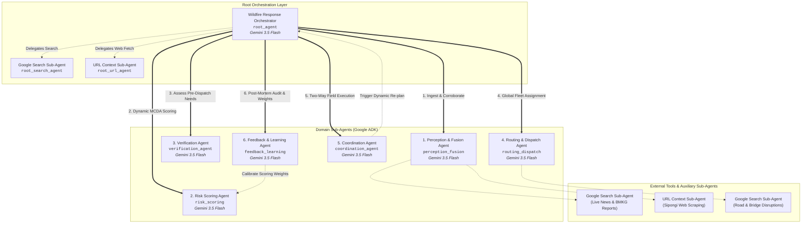
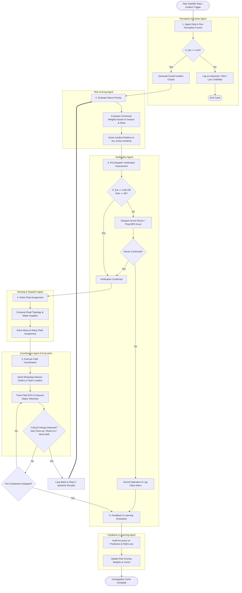
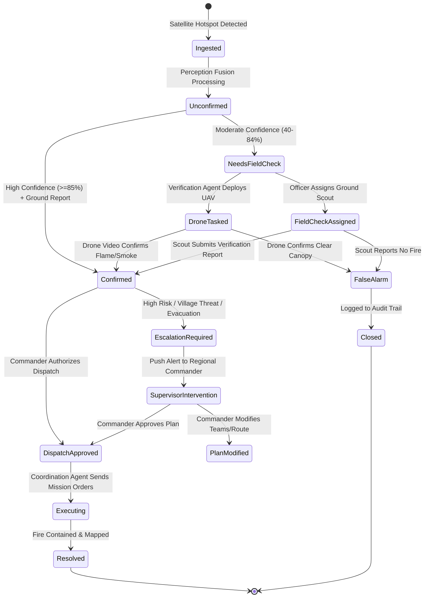

# Agen Karhutla — Multi-Agent Architecture

## 1. Overview

**SIGAP (Sistem Informasi dan Tanggap Cepat Karhutla / Agen Karhutla)** is an enterprise multi-agent wildfire intelligence and automated response platform built for Indonesian disaster response authorities, specifically:
- **BPBD (Badan Penanggulangan Bencana Daerah)** — Regional disaster management command centers managing emergency logistics and civil protection.
- **Manggala Agni (KLHK)** — The specialized wildfire brigade under the Ministry of Environment and Forestry operating on the frontline of forest and peatland suppression.
- **KPH (Kesatuan Pengelolaan Hutan)** — Forest Management Units overseeing regional concessions, conservation forests, and community boundaries.
- **Remote Sensing & Fire Analysts** — GIS specialists evaluating burn scar perimeters, carbon emissions, and fire behavior.

Rather than relying on legacy monolithic software or passive monitoring dashboards, SIGAP implements an advanced **multi-agent system** orchestrated using the **Google Agent Development Kit (ADK)** powered by **Gemini 3.5 Flash**. The system decomposes the complex, time-critical problem of wildfire management into **6 specialized sub-agents** coordinated by a central root agent (**Wildfire Response Orchestrator**).

```
+----------------------------------------------------------------------------------------------------+
|                                    WORKFLOW COMPARISON ARCHITECTURE                                |
+----------------------------------------------------------------------------------------------------+
| Dimension              | Traditional Rule-Based System             | SIGAP Multi-Agent System (ADK)        |
+------------------------+-------------------------------------------+---------------------------------------+
| Architectural Model    | Linear, static, per-ticket pipeline       | Cyclic, adaptive, cross-ticket graph  |
| Trigger & Perception   | Single raw hotspot triggers ticket        | Multi-sensor perception & fusion      |
| Verification           | Manual human inspection or ignored        | Autonomous verification agent (VOI)   |
| Risk Prioritization    | Static distance formula (Haversine)       | Dynamic contextual reasoning (MCDA)   |
| Resource Allocation    | Greedy 1-to-1 dispatch (nearest crew)     | Many-to-many global optimization      |
| Tactical Execution     | Broadcast SMS / static alert              | Two-way interactive field coordination|
| Dynamic Disruption     | Stalls; requires manual dispatcher reset  | Continuous re-planning loop           |
| Long-term Learning     | Fixed configuration parameters            | Automated post-incident feedback loop |
+------------------------+-------------------------------------------+---------------------------------------+
```

### Detailed Workflow Comparison

#### Traditional Rule-Based Approach
```text
[Hotspot Detected] ──► [Match Nearest Village] ──► [Create Single Ticket] ──► [Alert Crew] ──► [Escalate if no ACK]
```
1. **Isolated & Per-Ticket:** Evaluates each thermal anomaly in isolation without cross-referencing adjacent clusters, regional smoke dispersion, or macro-level fire front behavior.
2. **Greedy Nearest-Neighbor Dispatch:** Matches Hotspot $A$ to the nearest team $X$. If a catastrophic fire emerges at Hotspot $B$ ten minutes later, Team $X$ is already unavailable, stranding higher-priority assets.
3. **Rigid Escalation Timers:** If a crew does not respond within $N$ minutes, the ticket is forwarded to an upper tier without understanding whether the crew is engaged in transit, cut off by destroyed road bridges, or in an area lacking cellular coverage.
4. **Static Heuristics:** Relies on hardcoded distance thresholds regardless of whether the fire is burning deep in drained peat or across rocky, mineral soil.

#### Agentic Multi-Agent Approach
```text
                     ┌────────────────────────────────────────────────────────┐
                     │            Cyclic Re-planning Feedback Loop            │
                     ▼                                                        │
[Hotspot Feed] ──► [Perception & Fusion] ──► [Risk Scoring] ──► [Verification]─┴─► [Routing & Dispatch] ──► [Coordination]
                                                                                                                │
                                                                                                      [Feedback & Learning]
```
1. **Credibility Assessment:** Hotspot detections from NASA FIRMS (VIIRS/MODIS), KLHK Sipongi, BMKG meteorological stations, and community reports are fused by the **Perception & Fusion Agent** to filter out industrial flares, solar glint, and false positives.
2. **Pre-Dispatch Verification:** The **Verification Agent** performs a Value of Information (VOI) assessment, determining whether to deploy aerial drones or notify village volunteers (MPA) before mobilizing heavy fire engines.
3. **Global Multi-Hotspot Risk Scoring:** The **Risk Scoring Agent** ranks active incidents relative to **all concurrent hotspots**, reasoning over peatland depth, fuel moisture, wind vectors, and settlement smoke hazards.
4. **Many-to-Many Optimization:** The **Routing & Dispatch Agent** evaluates $N$ response teams against $M$ prioritized incidents, computing true road-network topology, canal water availability, and terrain barriers to minimize total regional damage.
5. **Two-Way Operational Coordination:** The **Coordination Agent** maintains live contact with crews via WhatsApp and field telemetry, streaming live ETAs and reporting barrier updates.
6. **Dynamic Recomposition:** If weather patterns shift (e.g., wind reverses toward an urban center) or a high-intensity fire breaks out, the Orchestrator halts execution and **recomposes the global dispatch plan**.
7. **Continuous Calibration:** Following incident resolution, the **Feedback & Learning Agent** audits prediction accuracy against field realities and autonomously updates weighting parameters.

---

## 2. Agent Hierarchy

The system follows a hierarchical delegation pattern. The root **Wildfire Response Orchestrator** governs workflow sequencing, global state reconciliation, and dynamic re-planning, while delegating specialized analysis to six purpose-built sub-agents. 

### 2.1 Hierarchy Diagram



### 2.2 Agent Roster & Tool Registry

| Agent Name | Python Variable Name | Primary Operational Role | Core Tools / Integrations | Dedicated Sub-Agents |
|---|---|---|---|---|
| **Wildfire Response Orchestrator** | `root_agent` | Central coordinator; plans workflow, delegates sub-tasks, handles re-planning, compiles SITREP. | `compile_sitrep_tool`, `publish_bulletin_tool` | `root_search_agent`, `root_url_agent` |
| **Perception & Fusion Agent** | `perception_fusion` | Fuses multi-satellite sensors (FIRMS, Sipongi), BMKG weather, and citizen reports; resolves conflicts. | `firms_query_tool`, `sipongi_sync_tool`, `bmkg_weather_tool`, `dbscan_cluster_tool` | `perception_search_agent`, `perception_url_agent` |
| **Risk Scoring Agent** | `risk_scoring` | Contextual multi-criteria risk scoring; adjusts weights based on dry season, peatland, and smoke vectors. | `peatland_overlay_tool`, `settlement_proximity_tool`, `wind_dispersion_tool`, `trend_analysis_tool` | None |
| **Verification Agent** | `verification_agent` | Value of Information (VOI) engine; determines if drone, satellite, or community check is needed before dispatch. | `gee_imagery_tool`, `drone_tasking_tool`, `community_query_tool` | None |
| **Routing & Dispatch Agent** | `routing_dispatch` | Global many-to-many fleet allocation; optimizes crew-to-fire mapping based on roads, terrain, and water bodies. | `road_network_routing_tool`, `water_source_finder_tool`, `fleet_status_tool` | `routing_search_agent` |
| **Coordination Agent** | `coordination_agent` | Field communications; sends mission packages, tracks crew GPS, streams ETAs, escalates life-safety hazards. | `whatsapp_broadcast_tool`, `field_telemetry_tool`, `supervisor_alert_tool` | None |
| **Feedback & Learning Agent** | `feedback_learning` | Post-incident evaluation; audits prediction errors, evaluates suppression times, and updates model weights. | `incident_history_tool`, `weight_calibration_tool`, `audit_logger_tool` | None |

---

## 3. Technology Stack

### 3.1 Google ADK (Agent Development Kit)
SIGAP uses the **Google Agent Development Kit (ADK)** as its agent orchestration framework. Google ADK provides:
- First-class primitives for multi-agent delegation (`Agent`, `SubAgent`, and parent-child communication channels).
- Native support for tool calling, function declarations, and JSON schema validation.
- Built-in integrations for search engines (`GoogleSearchTool`) and document ingestion (`UrlContextTool`).
- Robust session memory and event-driven control loops.

### 3.2 The GlobalGemini Class & Vertex AI Global Routing

#### Why Subclassing Gemini is Mandatory
Google's next-generation **Gemini 3-series** foundation models (specifically **Gemini 3.5 Flash**) are served exclusively through the Vertex AI **`global`** endpoint location (`global-aiplatform.googleapis.com`), rather than traditional regional endpoints such as `us-central1`, `asia-southeast1`, or `europe-west4`.

Standard ADK `Gemini` client wrappers default to regional routing derived from ambient environment variables (`GOOGLE_CLOUD_REGION` or `VERTEX_AI_LOCATION`). When an ADK application attempts to instantiate `gemini-3.5-flash` against a regional endpoint (e.g., `us-central1-aiplatform.googleapis.com`), Vertex AI throws an error:
```text
NotFound: 404 Publisher Model `projects/.../locations/us-central1/publishers/google/models/gemini-3.5-flash` not found. 
Gemini 3-series models are currently only supported in the 'global' region.
```

To prevent runtime failures and ensure seamless ADK integration, SIGAP defines a dedicated `GlobalGemini` class that intercepts client initialization and explicitly routes all requests to Vertex AI's `global` control plane.

#### Implementation: `GlobalGemini`
```python
"""sigap/agent/models/global_gemini.py

Custom Gemini model wrapper for Google ADK ensuring Vertex AI routing
to the 'global' endpoint required by Gemini 3-series models.
"""

import os
import logging
from typing import Any, Dict, Optional
from google.adk.models import Gemini
from google.api_core.client_options import ClientOptions

logger = logging.getLogger("SIGAP.Agent.GlobalGemini")


class GlobalGemini(Gemini):
    """Subclass of ADK Gemini forcing Vertex AI client requests to the 'global' location.

    Attributes:
        model: Model name string (defaults to 'gemini-3.5-flash').
        location: Forced to 'global'.
        client_options: Configured with api_endpoint='global-aiplatform.googleapis.com'.
    """

    DEFAULT_MODEL = "gemini-3.5-flash"
    GLOBAL_ENDPOINT = "global-aiplatform.googleapis.com"
    GLOBAL_LOCATION = "global"

    def __init__(
        self,
        model: str = DEFAULT_MODEL,
        temperature: float = 0.2,
        max_output_tokens: Optional[int] = None,
        client_options: Optional[ClientOptions] = None,
        **kwargs: Any,
    ) -> None:
        """Initialize the GlobalGemini model instance."""
        # 1. Force location parameter to 'global'
        kwargs["location"] = self.GLOBAL_LOCATION

        # 2. Configure endpoint to global-aiplatform.googleapis.com
        if client_options is None:
            client_options = ClientOptions(api_endpoint=self.GLOBAL_ENDPOINT)
        else:
            client_options.api_endpoint = self.GLOBAL_ENDPOINT

        kwargs["client_options"] = client_options

        # 3. Ensure environment variables do not override global routing
        project_id = kwargs.get("project") or os.getenv("GOOGLE_CLOUD_PROJECT")
        if not project_id:
            logger.warning("GOOGLE_CLOUD_PROJECT is not explicitly set; falling back to ADC.")

        logger.info(
            f"Initializing GlobalGemini: model={model}, location={self.GLOBAL_LOCATION}, "
            f"endpoint={self.GLOBAL_ENDPOINT}"
        )

        super().__init__(
            model=model,
            temperature=temperature,
            max_output_tokens=max_output_tokens,
            **kwargs,
        )
```

#### Instantiating Agents with GlobalGemini
```python
from sigap.agent.models.global_gemini import GlobalGemini
from google.adk.agents import Agent

# Instantiate shared model reference
gemini_model = GlobalGemini(
    model="gemini-3.5-flash",
    temperature=0.1,  # Low temperature for deterministic operational logic
)

# Root agent configured with GlobalGemini
root_agent = Agent(
    name="wildfire_response_orchestrator",
    model=gemini_model,
    instruction="Coordinate autonomous wildfire response across all active Indonesian jurisdictions.",
)
```

---

## 4. Agent Specifications

---

### 4.1 Perception & Fusion Agent

#### Purpose
The **Perception & Fusion Agent** is responsible for continuous situational awareness and sensor corroboration. It ingests thermal anomaly observations from NASA FIRMS, the Indonesian Ministry of Environment and Forestry's Sipongi portal, BMKG meteorological stations, and local community observations. It resolves sensor discrepancies (e.g., high-confidence VIIRS detection vs. no MODIS detection due to orbit timing or spatial resolution) and determines the calibrated probability $P(\text{real\_fire})$.

#### Technical Parameters
- **Python Variable:** `perception_fusion`
- **Model:** `GlobalGemini(model="gemini-3.5-flash", temperature=0.1)`
- **Tools:** `firms_query_tool`, `sipongi_sync_tool`, `bmkg_weather_tool`, `dbscan_cluster_tool`
- **Sub-Agents:** `perception_search_agent` (GoogleSearchTool for local news/social reports), `perception_url_agent` (UrlContextTool for scraping official provincial agency bulletins)

#### Input Contract
```json
{
  "temporal_window": {
    "start_utc": "2026-10-21T00:00:00Z",
    "end_utc": "2026-10-21T12:00:00Z"
  },
  "geographic_bounds": {
    "province": "Kalimantan Tengah",
    "regency": "Pulang Pisau",
    "bbox": [113.80, -3.20, 114.50, -2.50]
  },
  "field_reports": [
    {
      "report_id": "REP-20261021-001",
      "reporter_type": "COMMUNITY_MPA",
      "location": [-2.8541, 114.1205],
      "description": "Thick white smoke observed rising from peat canal zone.",
      "timestamp": "2026-10-21T10:15:00Z"
    }
  ]
}
```

#### Output Contract
```json
{
  "status": "FUSED",
  "fused_clusters": [
    {
      "cluster_id": "CLS-PLS-001",
      "centroid": [-2.8512, 114.1250],
      "bounding_box": [114.1100, -2.8600, 114.1400, -2.8400],
      "hotspot_count": 8,
      "mean_frp_mw": 48.7,
      "max_frp_mw": 112.4,
      "calibrated_fire_probability": 0.94,
      "sensor_corroboration": {
        "viirs_snpp": { "detected": true, "confidence": "high", "count": 5 },
        "viirs_noaa20": { "detected": true, "confidence": "high", "count": 3 },
        "modis_terra": { "detected": false, "reason": "ORBIT_TIMING_MISMATCH" },
        "sipongi_klhk": { "detected": true, "confidence": "high" },
        "bmkg_fwi": { "ffmc": 88.5, "isi": 12.1, "danger_level": "EXTREME" },
        "field_corroboration": true
      },
      "conflict_notes": "MODIS missed cluster due to satellite overpass timing (03:30 UTC), but dual VIIRS passes and field report corroborate severe peat ignition."
    }
  ]
}
```

#### Decision & Conflict Resolution Logic
The agent evaluates sensor conflicts using Bayesian updates and sensor physics:
1. **Resolution Mismatch:** VIIRS ($375\text{ m}$) detects smaller, lower-intensity smoldering fires that MODIS ($1\text{ km}$) cannot register. A positive VIIRS detection without a MODIS detection is **not** treated as a false positive if Fire Radiative Power (FRP) is consistent with early smoldering ($< 50\text{ MW}$).
2. **Solar Glint & Industrial Noise:** Candidate hotspots within $500\text{ m}$ of known palm oil processing mills, refineries, or metal roofs with FRP persisting identically throughout all four seasons are filtered out as fixed industrial heat sources.
3. **Cloud Gaps & Multi-Satellite Fusion:** If Sensor A flags high confidence but Sensor B indicates cloud cover over the same pixel, the agent queries meteorological cloud drift from BMKG. If clear-sky gap probability was $> 0.30$ during Sensor A's overpass, the detection is upheld with $P(\text{real\_fire}) \ge 0.85$.

---

### 4.2 Risk Scoring Agent

#### Purpose
The **Risk Scoring Agent** performs dynamic, context-aware Multi-Criteria Decision Analysis (MCDA). Unlike rigid static scoring scripts, this agent applies LLM reasoning over environmental parameters, adapting factor weights according to seasonal severity, soil characteristics, and atmospheric transport hazards.

#### Technical Parameters
- **Python Variable:** `risk_scoring`
- **Model:** `GlobalGemini(model="gemini-3.5-flash", temperature=0.2)`
- **Tools:** `peatland_overlay_tool`, `settlement_proximity_tool`, `wind_dispersion_tool`, `trend_analysis_tool`
- **Sub-Agents:** None (deterministic GIS tools provide inputs)

#### Factors Evaluated
- **Substrate & Peatland Vulnerability:** Evaluates Ministry of Agriculture / KLHK peatland maps. Peat soils ($> 3\text{ m}$ depth, hemic/sapric) receive maximum vulnerability due to underground smoldering and immense carbon emissions.
- **Settlement & Asset Proximity:** Computes Euclidean and road-buffer distance to villages (*kampung*), schools, hospitals, and national infrastructure.
- **Atmospheric Smoke Plume Vectors:** Uses BMKG surface wind directions and speed ($10\text{ m}$ altitude) to simulate downwind smoke dispersion trajectories toward populated urban centers.
- **Spatiotemporal Cluster Growth:** Tracks rate of spread ($\Delta \text{hectares}/\text{hour}$) across consecutive satellite overpasses.
- **Historical Recurrence:** Cross-references historical 10-year fire perimeters. Repeated fire scars indicate intentional concession burn cycles or drainage degradation.

#### Dynamic Weighting Behavior
Weights adapt dynamically based on climatic season and regional vulnerability:
- **Peak Dry Season / El Niño Alert (August–October):** Peatland weight increases from $0.25$ to $0.45$; settlement proximity weight adjusts to $0.30$.
- **Transboundary Smoke Threat:** If prevailing winds blow directly toward international flight paths or major metropolitan centers (e.g., Palangka Raya or Pekanbaru), the downwind population hazard multiplier scales up by $1.5\times$.

$$\text{Risk Score} = w_{\text{peat}}(t) \cdot S_{\text{peat}} + w_{\text{settle}}(t) \cdot S_{\text{settle}} + w_{\text{wind}}(t) \cdot S_{\text{smoke}} + w_{\text{growth}} \cdot S_{\text{growth}} + w_{\text{recur}} \cdot S_{\text{recur}}$$

#### Input Contract
```json
{
  "fused_clusters": [
    {
      "cluster_id": "CLS-PLS-001",
      "centroid": [-2.8512, 114.1250],
      "hotspot_count": 8,
      "mean_frp_mw": 48.7,
      "calibrated_fire_probability": 0.94
    }
  ],
  "meteorological_conditions": {
    "wind_speed_kmh": 22.4,
    "wind_direction_deg": 135.0,
    "days_since_rain": 14,
    "el_nino_phase": "MODERATE_EL_NINO"
  }
}
```

#### Output Contract
```json
{
  "ranked_incidents": [
    {
      "cluster_id": "CLS-PLS-001",
      "priority_rank": 1,
      "composite_risk_score": 93.8,
      "factor_breakdown": {
        "peatland_vulnerability": 98.0,
        "settlement_smoke_hazard": 92.5,
        "growth_rate_score": 88.0,
        "historical_recurrence": 85.0
      },
      "active_weights": {
        "peatland": 0.40,
        "settlement_proximity": 0.30,
        "wind_smoke_vector": 0.15,
        "growth_trend": 0.10,
        "recurrence": 0.05
      },
      "reasoning_rationale": "High priority: Cluster is situated directly over deep Ombrogenous Peat (>3m depth) along the Sebangau basin. Active SE wind (135 deg at 22 km/h) is pushing dense particulate matter toward the northern perimeter of Palangka Raya (12 km away). Extreme drought index warrants immediate tactical containment."
    }
  ]
}
```

---

### 4.3 Verification Agent

#### Purpose
The **Verification Agent** implements an automated **Value of Information (VOI)** decision framework. It determines whether a high-risk or ambiguous fire detection requires pre-dispatch verification (e.g., aerial UAV reconnaissance, high-resolution optical satellite tasking via PlanetScope/Sentinel-2, or dispatching a village Masyarakat Peduli Api scout) prior to deploying full suppression crews and water tankers.

#### Technical Parameters
- **Python Variable:** `verification_agent`
- **Model:** `GlobalGemini(model="gemini-3.5-flash", temperature=0.1)`
- **Tools:** `gee_imagery_tool`, `drone_tasking_tool`, `community_query_tool`
- **Sub-Agents:** None

#### Decision Framework & Economic Trade-off
The agent continuously balances the operational cost of mobilizing a false positive against the catastrophic risk of a delayed response to an underground peat fire:

$$\text{Expected Cost of Direct Dispatch} = (1 - P(\text{fire})) \cdot C_{\text{false\_alarm\_dispatch}} + P(\text{fire}) \cdot C_{\text{suppression\_early}}$$

$$\text{Expected Cost of Verification} = C_{\text{recon}} + P(\text{fire}) \cdot \left[ C_{\text{suppression\_delayed}} + \Delta_{\text{spread}}(\tau_{\text{recon}}) \cdot D_{\text{peat}} \right]$$

Where:
- $C_{\text{false\_alarm\_dispatch}}$: Fuel, personnel wear, pump mobilization, and opportunity cost of diverting teams from other zones ($\sim \$1,200$).
- $\Delta_{\text{spread}}(\tau_{\text{recon}}) \cdot D_{\text{peat}}$: Exponential cost growth when an underground peat fire expands during the reconnaissance delay $\tau_{\text{recon}}$ ($\sim \$8,000/\text{hr}$).

#### Operational Rules
1. **Immediate Direct Dispatch ($P(\text{fire}) \ge 0.85$ and Risk Score $\ge 80$):** High confidence on peatland near settlements bypasses pre-dispatch verification entirely. The agent issues `DIRECT_DISPATCH`.
2. **Drone Reconnaissance ($0.50 \le P(\text{fire}) < 0.85$ and Distance $< 15\text{ km}$ from Drone Hub):** Rapid UAV inspection confirms visual flame/smoke coordinates within 20 minutes.
3. **Community Scout Check ($0.40 \le P(\text{fire}) < 0.85$ and Remote Peat):** Automated ping sent to nearest registered Masyarakat Peduli Api (MPA) field volunteer.
4. **Hold & Satellite Monitoring ($P(\text{fire}) < 0.40$):** Sensor anomaly logged; queued for next satellite pass without spending field resources.

#### Input/Output Contract
```json
// Input
{
  "cluster_id": "CLS-PLS-001",
  "calibrated_fire_probability": 0.72,
  "composite_risk_score": 86.5,
  "closest_crew_distance_km": 38.0,
  "closest_drone_hub_distance_km": 11.2,
  "nearest_mpa_community": "Desa Bereng Bengkel"
}

// Output
{
  "verification_action": "TASK_DRONE_RECONNAISSANCE",
  "rationale": "Confidence is 72% with high peat risk score (86.5), but crew travel distance is 38 km over difficult logging tracks. Dispatching Hub-2 UAV provides visual confirmation in 18 minutes, preventing unnecessary mobilization of 14 personnel if anomaly is localized land-clearing stubble.",
  "target_coordinates": [-2.8512, 114.1250],
  "timeout_minutes": 25,
  "fallback_plan": "If drone telemetry fails within 25 minutes, automatically escalate to DIRECT_DISPATCH."
}
```

---

### 4.4 Routing & Dispatch Agent

#### Purpose
The **Routing & Dispatch Agent** executes a **many-to-many global fleet optimization**. Traditional dispatch algorithms greedily match a single fire to the nearest available crew, leading to severe sub-optimality during peak fire seasons with dozens of simultaneous ignitions. This agent solves a global assignment problem ($N$ response units $\times$ $M$ prioritized wildfires) to minimize total regional burn damage.

#### Technical Parameters
- **Python Variable:** `routing_dispatch`
- **Model:** `GlobalGemini(model="gemini-3.5-flash", temperature=0.1)`
- **Tools:** `road_network_routing_tool`, `water_source_finder_tool`, `fleet_status_tool`
- **Sub-Agents:** `routing_search_agent` (GoogleSearchTool for real-time reports of flooded bridges, washed-out logging roads, or community roadblocks)

#### Real-World Operational Constraints
- **True Road Network Topology:** Rejects Euclidean straight-line distance. Calculates route graphs over OpenStreetMap, provincial highway vectors, and forestry concession tracks.
- **Bridge & Vehicle Weight Capacities:** Prevents heavy 5,000-liter water tankers from being routed across wooden rural peat bridges rated for $< 3\text{ tons}$.
- **Water Source Proximity:** Wildfire suppression in peat requires continuous high-volume pumping. The agent cross-references active river discharge, canal block reservoirs (*sekat kanal*), and retention basins within $1.5\text{ km}$ of the incident.
- **Crew Fatigue & Readiness:** Factors in hours on duty, equipment state (portable high-pressure pumps vs. backpack sprayers), and remaining fuel.

#### Input Contract
```json
{
  "active_incidents": [
    { "incident_id": "INC-01", "location": [-2.8512, 114.1250], "priority_score": 93.8, "required_crews": 2 },
    { "incident_id": "INC-02", "location": [-2.7210, 114.3310], "priority_score": 74.2, "required_crews": 1 }
  ],
  "available_resources": [
    { "team_id": "MAG-DAOP-01", "type": "Manggala Agni Daops I", "base_coords": [-2.2150, 113.9180], "equipment": ["PUMP_MARK3", "TANKER_3000L"], "status": "AVAILABLE" },
    { "team_id": "BPBD-REG-03", "type": "BPBD Quick Response", "base_coords": [-2.9100, 114.0500], "equipment": ["PORTABLE_PUMP", "PERSONNEL_TRUCK"], "status": "AVAILABLE" },
    { "team_id": "MPA-DESA-05", "type": "Masyarakat Peduli Api", "base_coords": [-2.8600, 114.1100], "equipment": ["BACKPACK_SPRAYERS"], "status": "AVAILABLE" }
  ]
}
```

#### Output Contract
```json
{
  "optimization_status": "OPTIMAL_GLOBAL_ASSIGNMENT",
  "assignments": [
    {
      "incident_id": "INC-01",
      "assigned_teams": ["BPBD-REG-03", "MPA-DESA-05"],
      "primary_access_route": "Jl. Trans Kalimantan -> Sp. Bereng -> Logging Track 4",
      "road_distance_km": 21.4,
      "estimated_travel_time_min": 42,
      "identified_water_source": {
        "type": "CANAL_BLOCK_RESERVOIR",
        "distance_m": 350,
        "coordinates": [-2.8530, 114.1220],
        "estimated_depth_m": 1.8
      },
      "hazard_warning": "Logging Track 4 has sandy peat shoulders; heavy tankers must park at Sp. Bereng and lay 400m hose lines."
    },
    {
      "incident_id": "INC-02",
      "assigned_teams": ["MAG-DAOP-01"],
      "road_distance_km": 54.8,
      "estimated_travel_time_min": 68,
      "identified_water_source": {
        "type": "RIVER_KAHAYAN",
        "distance_m": 600,
        "coordinates": [-2.7250, 114.3260]
      }
    }
  ]
}
```

---

### 4.5 Coordination Agent

#### Purpose
The **Coordination Agent** acts as the two-way operational bridge between the AI system and field personnel. It automates mission package delivery, tracks unit GPS telemetry, updates ETAs, resolves field-reported hurdles, and enforces safety escalation protocols when human lives or critical perimeters are threatened.

#### Technical Parameters
- **Python Variable:** `coordination_agent`
- **Model:** `GlobalGemini(model="gemini-3.5-flash", temperature=0.2)`
- **Tools:** `whatsapp_broadcast_tool`, `field_telemetry_tool`, `supervisor_alert_tool`
- **Sub-Agents:** None

#### Operational Protocols & Communication Channels
- **WhatsApp Field Integration:** Dispatches concise, actionable mission briefings in Indonesian directly to team leaders' mobile devices via WhatsApp Business API. Includes Google Maps pin links, water source locations, and tactical hazards.
- **Two-Way Message Parsing:** Ingests field SMS/WhatsApp replies (e.g., *"Jalan putus di KM 12, cari jalur alternatif"* or *"Pompa Mark-3 rusak, butuh unit cadangan"*).
- **Automated Human Supervisor Escalation:**
  - Fire perimeter breaches within $500\text{ m}$ of a village settlement boundary.
  - Crew safety warnings: wind direction reverses, threatening to trap firefighting personnel in a peat pocket.
  - Recommended civil evacuation orders (*Peringatan Dini Evakuasi Warga*).

#### Input/Output Contract
```json
// Input: Field update from Team Leader
{
  "source": "FIELD_WHATSAPP",
  "sender": "+6281234567890",
  "team_id": "BPBD-REG-03",
  "incident_id": "INC-01",
  "message_text": "Jembatan kayu di parit 4 patah, mobil tangki tidak bisa lewat. Kami jalan kaki bawa pompa apung.",
  "telemetry": { "lat": -2.8580, "lon": 114.1180, "timestamp": "2026-10-21T11:05:00Z" }
}

// Output: Coordination Action & Broadcast
{
  "action_type": "TACTICAL_ADAPTATION",
  "crew_response": "Pesan diterima BPBD-REG-03. Posisi Anda 1.2 km dari titik api. Tim MPA-DESA-05 sedang merapat dari arah timur dengan selang tambahan.",
  "system_action": "UPDATE_CREW_ETA",
  "revised_eta_minutes": 55,
  "escalate_to_supervisor": false,
  "logged_road_hazard": {
    "location": [-2.8580, 114.1180],
    "hazard": "BROKEN_WOODEN_BRIDGE",
    "vehicle_restriction": "ALL_VEHICLES_BLOCKED"
  }
}
```

---

### 4.6 Feedback & Learning Agent

#### Purpose
The **Feedback & Learning Agent** performs post-incident retrospective analysis to drive continuous system improvement. It compares initial satellite confidence against field-verified reality, assesses whether prioritization was optimal, measures suppression duration, and calibrates scoring weights for subsequent operations.

#### Technical Parameters
- **Python Variable:** `feedback_learning`
- **Model:** `GlobalGemini(model="gemini-3.5-flash", temperature=0.1)`
- **Tools:** `incident_history_tool`, `weight_calibration_tool`, `audit_logger_tool`
- **Sub-Agents:** None

#### Learning Mechanics
- **Perception Calibration:** If satellite thermal anomalies were flagged with $90\%$ confidence but field investigation confirmed agricultural stubble burned in a controlled clearing without peat combustion, the agent adjusts false-alarm penalties for that specific land parcel.
- **Dynamic Weight Fine-Tuning:** If an incident ranked Priority 4 unexpectedly expanded into a major peat blaze because canal drainage depth was underweighted, the agent issues a calibrated weight proposal increasing the canal proximity factor in the **Risk Scoring Agent**.
- **Audit Trails:** Maintains an immutable JSONL audit ledger documenting every prediction, verification step, dispatch command, and outcome.

#### Input/Output Contract
```json
// Input: Post-incident closeout report
{
  "incident_id": "INC-01",
  "closeout_timestamp": "2026-10-21T18:00:00Z",
  "ground_truth_findings": {
    "actual_fire_occurred": true,
    "substrate_burned": "DEEP_PEAT",
    "total_burned_area_ha": 4.8,
    "containment_duration_hours": 5.2,
    "initial_priority_score": 93.8,
    "dispatch_success": true
  }
}

// Output: Calibration & Feedback Directive
{
  "incident_evaluation": "SUCCESSFUL_PREDICTION",
  "prediction_accuracy_score": 0.96,
  "observations": "Perception and risk scoring performed accurately. Deep peat smoldering matched predicted spread. Travel time was underestimated by 13 minutes due to wooden bridge failure.",
  "model_calibration_proposal": {
    "target_agent": "risk_scoring",
    "weight_modifications": {
      "canal_drainage_proximity": "+0.05",
      "historical_recurrence": "-0.05"
    },
    "routing_adjustment": {
      "unpaved_track_speed_modifier": 0.75
    }
  }
}
```

---

### 4.7 Wildfire Response Orchestrator (Root Agent)

#### Purpose
The **Wildfire Response Orchestrator** (`root_agent`) is the master reasoning and sequencing engine of the SIGAP architecture. It coordinates the lifecycle of an emergency response, determines which sub-agent to invoke, reconciles intermediate findings, synthesizes executive situation reports (SITREP), and manages **system-wide re-planning**.

#### Technical Parameters
- **Python Variable:** `root_agent`
- **Model:** `GlobalGemini(model="gemini-3.5-flash", temperature=0.1)`
- **Tools:** `compile_sitrep_tool`, `publish_bulletin_tool`
- **Sub-Agents:** Coordinates all 6 specialized domain agents; also directly controls `root_search_agent` and `root_url_agent` for top-level regulatory and meteorological inquiries.

#### Delegation Pattern
```text
                  [User Request / Hotspot Trigger]
                                 │
                                 ▼
                     [Wildfire Response Orchestrator]
                                 │
     ┌───────────────────────────┼───────────────────────────┐
     ▼                           ▼                           ▼
[1. Perception & Fusion] ──► [2. Risk Scoring] ──► [3. Verification Agent]
                                                             │
                                                             ▼
                                                 [Confirmation Granted?]
                                                 ├── YES ──► [4. Routing & Dispatch]
                                                 │                 │
                                                 │                 ▼
                                                 │           [5. Coordination Agent]
                                                 └── NO  ──► [Task Drone/Scout]
```

#### Dynamic Re-Planning Architecture
When environmental or operational conditions undergo a critical state shift, the Orchestrator does **not** patch the plan with local heuristics. It performs a **systemic re-planning cycle**:
1. **Trigger Event:** Perception Agent detects a new cluster with extreme FRP ($> 200\text{ MW}$) within $1\text{ km}$ of a major settlement, or Coordination Agent logs a sudden gale-force wind shift.
2. **Interrupt & Freeze:** Orchestrator sends an interrupt signal to all active agents, freezing non-committed dispatches.
3. **Re-Score:** Re-invokes `risk_scoring` over all active incidents simultaneously.
4. **Re-Optimize Fleet:** Re-invokes `routing_dispatch` with the updated incident priorities and real-time team coordinates.
5. **Re-Issue Directives:** Transmits revised route orders to teams in transit and notifies regional human commanders.

---

## 5. Workflow & Decision Flow

### 5.1 End-to-End Agentic Lifecycle Diagram



---

## 6. Tool Integration

### 6.1 Architecture: How ADK Tools Wrap the `data/` Layer
SIGAP follows clean architectural separation: heavy mathematical calculations, remote sensing downloads, database queries, and neural network inference reside in standalone Python modules inside `data/` and `ml/`. 

The `agent/tools/` layer contains **ADK tool wrappers**. These wrappers:
1. Translate JSON arguments from the Gemini model into validated Python parameters using Pydantic.
2. Execute the deterministic domain functions.
3. Handle exceptions, apply timeouts, and format outputs into concise, structured dictionaries optimal for LLM context consumption.

```
+─────────────────────────────────────────────────────────────+
|               Google ADK Multi-Agent Core                   |
|           (Gemini 3.5 Flash via GlobalGemini)               |
+─────────────────────────────────────────────────────────────+
                               │
                Function Call / JSON Schema
                               ▼
+─────────────────────────────────────────────────────────────+
|                     ADK Tool Wrappers                       |
|           (Decorated with @agent_tool or Tool)              |
+─────────────────────────────────────────────────────────────+
                               │
               Typed Python Method Calls & Arrays
                               ▼
+──────────────────────────────┬──────────────────────────────+
|    data/ Layer Modules       |     ml/ Deep Learning Layer  |
|  - data/firms/client.py      |   - ml/unet/predict.py       |
|  - data/earth_engine/client  |   - ml/unet/postprocessing.py|
|  - data/geospatial/dnbr.py   |   - ml/unet/model.py         |
|  - data/geospatial/priority  |                              |
+──────────────────────────────┴──────────────────────────────+
```

### 6.2 Tool Inventory

| Tool Name | Assigned Agent | Underlying Module | Description |
|---|---|---|---|
| `firms_query_tool` | `perception_fusion` | `data.firms.client.FIRMSClient` | Asynchronously queries NASA FIRMS API for VIIRS/MODIS thermal anomalies across specified bounding boxes. |
| `sipongi_sync_tool` | `perception_fusion` | `data.firms.sipongi_client` | Synchronizes official KLHK Sipongi hotspot reports and ground-truthed field logs. |
| `bmkg_weather_tool` | `perception_fusion`, `risk_scoring` | `data.weather.bmkg_client` | Retrieves real-time wind speed, wind azimuth, relative humidity, and Fire Weather Index (FWI) metrics. |
| `dbscan_cluster_tool`| `perception_fusion` | `data.geospatial.clustering` | Applies spherical Haversine DBSCAN to cluster raw points into cohesive fire fronts and centroids. |
| `peatland_overlay_tool`| `risk_scoring` | `data.geospatial.priority` | Intersects incident boundaries with KLHK peat thickness rasters ($< 1\text{m}$, $1\text{--}2\text{m}$, $> 3\text{m}$). |
| `settlement_proximity_tool`| `risk_scoring`| `data.geospatial.priority` | Measures road and Euclidean buffers to BPS human settlements and vital infrastructure. |
| `wind_dispersion_tool` | `risk_scoring` | `data.geospatial.dispersion` | Generates smoke dispersion cones predicting PM2.5 transport toward urban areas over $6\text{--}24$ hours. |
| `gee_imagery_tool` | `verification_agent` | `data.earth_engine.client.GEEClient` | Fetches pre/post Landsat 8/9 and Sentinel-2 surface reflectance scenes with QA pixel cloud masking. |
| `unet_segment_tool` | `verification_agent` | `ml.unet.predict.predict_burned_area` | Runs 6-band deep convolutional U-Net inference to segment burn scars and compute precise hectares. |
| `road_network_routing_tool`| `routing_dispatch`| `data.routing.osrm_engine` | Solves turn-by-turn routing over road networks, enforcing bridge tonnage and road surface constraints. |
| `water_source_finder_tool` | `routing_dispatch`| `data.geospatial.hydrology` | Locates verified canal blocks (*sekat kanal*), rivers, and retention ponds within tactical hose range. |
| `whatsapp_broadcast_tool` | `coordination_agent`| `data.comms.whatsapp_client` | Formats and transmits mission orders and geospatial coordinates to field crew smart devices. |
| `supervisor_alert_tool` | `coordination_agent`| `data.comms.alert_service` | Escalates life-safety risks, community evacuation alerts, or cross-border smoke alerts to commanders. |
| `weight_calibration_tool` | `feedback_learning` | `data.geospatial.priority` | Dynamically updates and persists baseline factor weights for the multi-criteria risk scoring engine. |

### 6.3 Defining Custom Tools with the `@agent_tool` Decorator

Google ADK allows exposing clean, type-annotated Python functions directly to agents using the `@agent_tool` decorator. The decorator automatically extracts function docstrings, argument types, and default values to compile the OpenAPI-compliant JSON tool declaration.

```python
"""sigap/agent/tools/custom_tool_example.py

Demonstrates how to build an ADK tool wrapping the underlying data/ layer.
"""

from typing import Dict, Any, List
from google.adk.tools import agent_tool
from pydantic import BaseModel, Field


class HotspotQueryArgs(BaseModel):
    bbox: List[float] = Field(
        ...,
        description="Bounding box [min_lon, min_lat, max_lon, max_lat] in EPSG:4326",
        min_length=4,
        max_length=4,
    )
    days_back: int = Field(default=1, description="Number of historical days to query (1-10)")
    min_confidence: str = Field(default="nominal", description="Minimum confidence: 'low', 'nominal', 'high'")


@agent_tool(
    name="query_firms_hotspots",
    description="Queries NASA FIRMS near-real-time satellite thermal anomalies across a geographic bounding box.",
)
async def query_firms_hotspots(
    bbox: List[float],
    days_back: int = 1,
    min_confidence: str = "nominal",
) -> Dict[str, Any]:
    """Execute asynchronous query against NASA FIRMS and return clustered hotspots."""
    from data.firms.client import FIRMSClient
    from data.geospatial.clustering import cluster_hotspots_haversine
    import os

    api_key = os.getenv("FIRMS_MAP_KEY")
    if not api_key:
        return {
            "status": "ERROR",
            "error_code": "AUTH_CONFIG_MISSING",
            "message": "FIRMS_MAP_KEY environment variable is not configured on the host.",
        }

    client = FIRMSClient(api_key=api_key)
    try:
        raw_hotspots = await client.get_area_hotspots(
            bbox=bbox,
            days=days_back,
            source="VIIRS_SNPP_NRT",
        )
        
        # Filter confidence
        filtered = [h for h in raw_hotspots if h.get("confidence") == min_confidence or min_confidence == "all"]
        
        # Spatial DBSCAN clustering via data/ layer
        clusters = cluster_hotspots_haversine(filtered, eps_km=2.0, min_samples=2)

        return {
            "status": "SUCCESS",
            "total_raw": len(raw_hotspots),
            "total_filtered": len(filtered),
            "cluster_count": len(clusters),
            "clusters": clusters,
        }
    except Exception as exc:
        return {
            "status": "FAILED",
            "error_type": type(exc).__name__,
            "message": str(exc),
        }
```

---

## 7. Recovery & Adaptation

Disaster monitoring environments are inherently prone to sensor disruptions, cloud interference, and network outages. SIGAP incorporates multi-layer recovery patterns to guarantee uninterrupted decision support.

```
+────────────────────────────────────────────────────────────────────────────────────────────────----+
|                                    FAILURE RECOVERY MATRIX                                         |
+────────────────────────────────────────────────────────────────────────────────────────────────----+
| Failure Mode          | Detection Mechanism            | Autonomous Recovery Strategy              |
+────────────────-------+--------------------------------+-------------------------------------------+
| Severe Cloud Cover    | GEE Tool returns >20% QA_PIXEL | 1. Expand temporal window by 7-14 days    |
| (Equatorial Tropics)  | cloud occlusion in AOI         | 2. Switch to Sentinel-1 SAR radar imagery |
|                       |                                | 3. Fallback to thermal-only risk scoring  |
+────────────────-------+--------------------------------+-------------------------------------------+
| External API Outage   | HTTP 5xx / 429 Rate Limit      | Circuit breaker activates; pivots to      |
| (FIRMS / Sipongi)     | Timeout > 30 seconds           | cached Redis thermal store & BMKG alerts  |
+────────────────-------+--------------------------------+-------------------------------------------+
| GPU CUDA Out-Of-Memory| PyTorch CUDA OOM exception     | Tiling manager slices scene into 512x512  |
| (U-Net Inference)     | during large scene inferencing | patches with overlapping boundary blend   |
+────────────────-------+--------------------------------+-------------------------------------------+
| Foundation Model Error| Gemini 3.5 API rate limit or   | Exponential backoff with jitter (3 tries);|
|                       | JSON schema validation error   | falls back to deterministic heuristic MCDA|
+────────────────-------+--------------------------------+-------------------------------------------+
| Road Network Cut Off  | Field WhatsApp report / OSRM   | Flags node as impassable; recalculates    |
| (Bridge Collapsed)    | impassable edge response       | multi-crew route via secondary tracks     |
+────────────────-------+--------------------------------+-------------------------------------------+
```

### 7.1 Circuit Breakers & Retry Policies
All external network interactions (FIRMS, GEE, Sipongi, WhatsApp API) are governed by an adaptive circuit breaker pattern:
- **Max Retries:** 3 attempts with exponential backoff ($2^n \text{ seconds}$) and $\pm 20\%$ jitter.
- **Circuit State Transition:** 5 consecutive failures trips the breaker to `OPEN` for 180 seconds. While open, the agent is supplied with synthetic degradation metadata, allowing it to complete reasoning without freezing the operational loop.

### 7.2 Continuous Risk Score Weight Learning
The system prevents drift through the **Feedback & Learning Agent**:
1. When field personnel mark an incident as resolved, the actual fire perimeter is digitized.
2. The agent calculates the **Brier Score** for the initial fire probability:
   $$\text{BS} = \frac{1}{N} \sum_{t=1}^N (P_t - o_t)^2$$
3. If the Brier Score exceeds $0.15$ over a 7-day rolling window, the agent initiates weight re-calibration, suppressing over-sensitive sensor feeds and recalibrating the baseline priors.

---

## 8. Human-in-the-Loop (HITL)

Agentic automation in SIGAP empowers field officers rather than supplanting command authority. The system operates under strict **human-in-the-loop boundaries**, reserving high-stakes decisions for accredited human supervisors.



### 8.1 Mandatory Human Escalation Triggers
The system immediately halts automated execution and alerts the human supervisor under the following conditions:
1. **Civil Evacuation Recommendations:** Risk Scoring Agent calculates that smoke concentrations ($PM_{2.5} > 300\ \mu\text{g/m}^3$) or fire fronts will intersect populated residential areas within 3 hours.
2. **Cross-Jurisdiction Resource Deployment:** Routing Agent recommends dispatching fire brigades across provincial or regency boundaries (e.g., deploying Central Kalimantan Daops into South Kalimantan).
3. **Severe Resource Depletion:** All regional response brigades are deployed, leaving zero reserve teams for new high-priority ignitions.
4. **Controlled Agricultural Burn Verification:** A landowner claims a detected hotspot is a permitted, canal-buffered traditional agricultural preparation fire (*kearifan lokal* under PPLH Law).

### 8.2 Verification Workflow States
Every incident tracked in SIGAP progresses through explicit lifecycle states:
- **`unconfirmed`:** Thermal anomaly registered; sensor fusion and corroboration in progress.
- **`needs_field_check`:** Moderate probability ($0.40 \le P < 0.85$); requires drone imagery or village scout confirmation.
- **`confirmed`:** Multi-sensor corroboration or physical ground verification completed; eligible for tactical suppression.
- **`false_alarm`:** Physical inspection or optical imagery confirmed industrial flare, cloud reflection, or clear canopy.

### 8.3 Comprehensive Audit Trail & Provenance
Every decision made by an agent is permanently serialized into a structured JSONL audit stream. Each log entry captures:
- Unique incident UUID and agent execution session ID.
- Exact model name (`gemini-3.5-flash`) and system prompt checksum.
- Tool input arguments and raw tool response payloads.
- Structured reasoning chain (*"Why this area was prioritized"* and *"Why drone verification was selected over direct dispatch"*).
- Human supervisor sign-offs, overrides, and timestamps.

---

## 9. Metrics & Evaluation

### 9.1 Target Performance Metrics

| Evaluation Metric | Baseline (Traditional Manual / Rule-Based) | Target (SIGAP Multi-Agent System) | Method of Measurement |
|---|---|---|---|
| **Detection-to-Dispatch Latency** | 120 – 240 minutes | **$\le 15$ minutes** | Duration from satellite ingestion to WhatsApp mission dispatch. |
| **False-Alarm Crew Dispatches** | 32% of total dispatches | **$< 8\%$ of total dispatches** | Post-incident logs where crews found no fire activity. |
| **Peatland Fire Damage Mitigation** | 68% expand underground | **$\ge 45\%$ contained in surface stage** | Hectares of deep peat burn scars mapped post-incident. |
| **Fleet Routing Travel Efficiency** | Unoptimized haversine matching | **$\ge 28\%$ reduction in transit time** | Actual transit duration vs. naive closest-crew assignment. |
| **Autonomous Recovery Success Rate** | 0% (stalls on error/clouds) | **$\ge 85\%$ without human reset** | Percentage of tool failures/cloud occlusions recovered autonomously. |
| **Re-Planning Execution Time** | 45 – 90 minutes (manual re-briefing) | **$< 60$ seconds** | Duration to calculate and distribute new global dispatch plan upon disruption. |

### 9.2 Operational Boundaries & Explicit Non-Claims

To ensure responsible and safe operational adoption by Indonesian disaster agencies, the capabilities of SIGAP are bounded by the following explicit caveats:

1. **Hotspots Are Not Confirmed Fires:** Satellite thermal anomalies represent radiant heat signatures, not verified blazes. An uncorroborated hotspot detection is never treated as definitive legal or operational proof of an illegal fire.
2. **Satellite Revisit Time Gaps:** Neither Landsat ($8\text{--}16\text{ days}$) nor Sentinel-2 ($5\text{ days}$) provides continuous real-time video surveillance. Fast-moving grass or crown fires can ignite, spread, and burn out between satellite passes.
3. **U-Net Segmentation is an Estimation:** Deep learning segmentations of burn scars represent probabilistic pixel classifications based on optical reflectance. Actual burned area calculations must be verified by ground GPS perimeter tracking or drone orthomosaics for legal prosecution.
4. **Cloud Occlusion Remains an Optical Barrier:** While the system autonomously seeks alternate dates and composites, dense equatorial cloud cover during monsoon transitions can temporarily blind optical sensors. In such conditions, radar (Sentinel-1) or field patrols must be prioritized.
5. **AI Advises; Commanders Decide:** The SIGAP multi-agent system provides tactical recommendations and optimized resource allocation proposals. Final operational command, civil evacuation orders, and firefighter deployment authority remain exclusively with human Incident Commanders (Komandan Satgas Karhutla).
