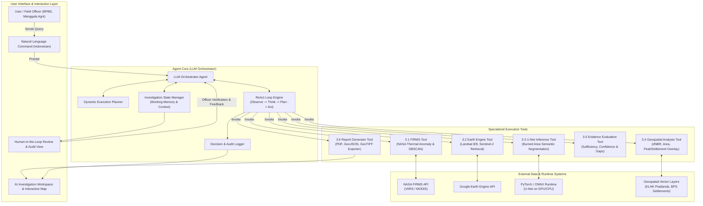
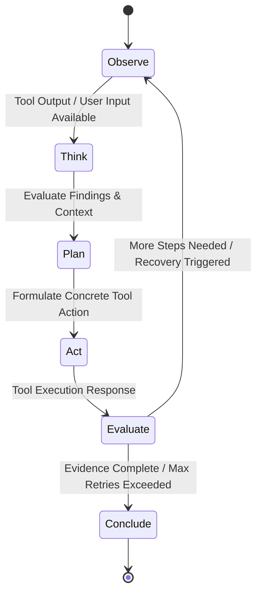
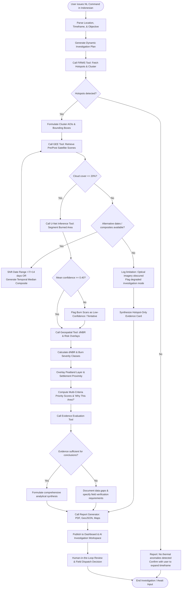
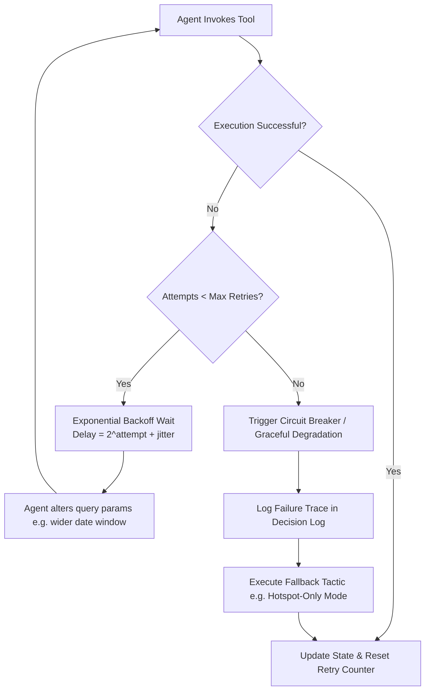
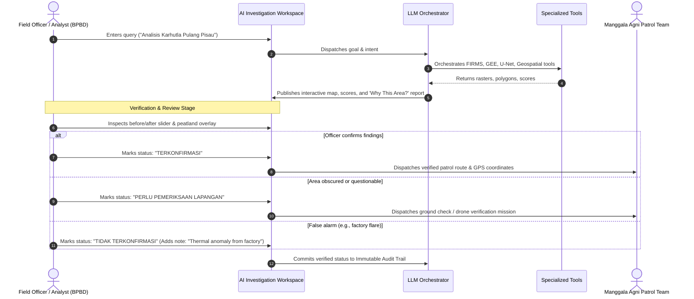

# Agen Karhutla — Agent Architecture

## 1. Overview

**SIGAP (Sistem Informasi dan Tanggap Cepat Karhutla / Agen Karhutla)** is an autonomous wildfire investigation and response prioritization platform engineered for Indonesian wildfire monitoring and disaster response agencies, including the Regional Disaster Management Agency (BPBD), Manggala Agni (Ministry of Environment and Forestry / KLHK), Forest Management Units (KPH), and specialized wildfire research analysts.

Wildfire investigation traditionally requires analysts to manually query thermal anomaly feeds, search satellite data catalogs, download heavy multi-spectral imagery, run localized deep learning segmentation or spectral index calculations, cross-reference peatland and settlement layers, and manually compile incident reports. This process takes hours to days—valuable time during which peatland fires can spread underground and become catastrophic.

SIGAP replaces this manual bottleneck with an **Agentic AI architecture** driven by a centralized **LLM Orchestrator Agent**. Rather than executing a rigid, linear script or serving as a passive data dashboard, the agent acts as an autonomous analytical investigator: it interprets high-level natural language instructions, formulates a multi-step investigation plan, dynamically selects and invokes specialized tools, critically inspects intermediate findings, recovers autonomously from environmental hurdles (such as equatorial cloud cover), and synthesizes evidence-based recommendations.

```
+-----------------------------------------------------------------------------------+
|                            TRADITIONAL DASHBOARD vs. SIGAP                        |
+-----------------------------------------------------------------------------------+
| Feature                    | Traditional Dashboard     | SIGAP Agentic AI         |
+----------------------------+---------------------------+--------------------------+
| Workflow Execution         | Rigid, pre-programmed     | Autonomous planning &    |
|                            | pipeline                  | dynamic step generation  |
| Tool Selection             | Hardcoded triggers        | Context-aware tool calls |
| Cloud Occlusion Handling   | Fails or returns blank    | Autonomous date/sensor   |
|                            | imagery                   | fallback & compositing   |
| Output Generation          | Raw charts & disconnected | Coherent investigation   |
|                            | map layers                | report with explanations |
| Reasoning & Transparency   | Black-box / manual user   | Traceable decision log & |
|                            | interpretation            | "Why This Area?" scores  |
+----------------------------+---------------------------+--------------------------+
```

### Key Agentic Capabilities

1. **Autonomous Planning:** Deconstructs complex user prompts (e.g., *"Investigate fire indicators in Pulang Pisau over the past 7 days, estimate burned area, and rank locations near settlements or peatlands"*) into an ordered execution graph covering thermal anomaly retrieval, satellite acquisition, inference, spatial overlay, and reporting.
2. **Dynamic Tool Selection:** Dispatches calls to specialized modules—NASA FIRMS, Google Earth Engine, U-Net Inference, and Geospatial Analysis engines—based on intermediate data availability and investigation requirements.
3. **Adaptive Recovery:** Detects obstacles in remote sensing data (e.g., heavy tropical cloud cover or missing satellite passes) and pivots to alternative acquisition windows, temporal composites, or secondary satellite constellations without human intervention.
4. **Evidence-Based Reasoning:** Evaluates whether gathered evidence meets minimum confidence thresholds before drawing conclusions, pairing automated detections with transparent multi-criteria risk scoring and explicit uncertainty bounds.

---

## 2. Agent Architecture

The SIGAP platform is organized around a central **LLM Orchestrator Agent** that controls the operational workflow while delegating all heavy numerical, geospatial, and neural computations to specialized deterministic tools.

### 2.1 Architectural Diagram



### 2.2 The ReAct Loop (Reason + Act)

The Orchestrator Agent implements a continuous **ReAct (Reasoning and Acting)** cycle throughout the investigation lifecycle:



- **Observe:** The agent inspects incoming user prompts, tool responses, satellite metadata, or error signals.
- **Think:** The agent evaluates data quality, checks whether criteria are satisfied (e.g., *Is cloud cover below 20%? Did FIRMS detect cluster concentrations?*), and reasons over what missing information is required.
- **Plan:** The agent selects the next best action, re-orders tasks, or selects an alternative recovery path if intermediate data fails quality checks.
- **Act:** The agent outputs a structured tool call with validated arguments.
- **Evaluate:** The agent benchmarks the returned tool data against evidence sufficiency rules, records the step in the `decision_log`, and determines whether to repeat the loop or finalize the investigation.

### 2.3 State Management Across Multi-Step Workflows

Multi-step investigations require persistent working memory to prevent hallucinations and context drift. The agent maintains an active `InvestigationState` object across the entire session:
- **Traceability:** Every intermediate output (hotspot GeoJSON, pre/post satellite scene IDs, raw dNBR GeoTIFF paths, polygon boundaries) is committed to structured state with unique UUIDs.
- **Context Economy:** Large rasters and spatial geometries are stored on local storage or cloud object stores; the LLM context receives only metadata summaries, statistical distributions, and bounding boxes.
- **Idempotency & Checkpoints:** If a downstream tool fails, the state manager allows the agent to roll back or re-execute from the last valid checkpoint without repeating expensive external API calls.

---

## 3. Tools

Each tool in the SIGAP architecture is an independent, deterministic software component exposed to the LLM Orchestrator via a strict JSON Schema interface.

---

### 3.1 FIRMS Tool (NASA FIRMS Hotspot Retrieval)

#### Purpose
Queries the NASA Fire Information for Resource Management System (FIRMS) API for thermal anomalies detected by VIIRS (Suomi NPP, NOAA-20, NOAA-21) and MODIS (Terra, Aqua) sensors across a designated administrative area or bounding box. It applies spatial clustering (DBSCAN) to group dispersed hotspot detections into cohesive candidate investigation clusters.

#### Input Schema
```json
{
  "$schema": "https://json-schema.org/draft/2020-12/schema",
  "title": "FIRMSQueryInput",
  "type": "object",
  "properties": {
    "region": {
      "type": "object",
      "properties": {
        "admin_name": { "type": "string", "description": "e.g., 'Pulang Pisau', 'Kalimantan Tengah'" },
        "bbox": {
          "type": "array",
          "items": { "type": "number" },
          "minItems": 4,
          "maxItems": 4,
          "description": "[min_lon, min_lat, max_lon, max_lat] in WGS84"
        }
      },
      "additionalProperties": false
    },
    "date_start": { "type": "string", "format": "date", "description": "YYYY-MM-DD" },
    "date_end": { "type": "string", "format": "date", "description": "YYYY-MM-DD" },
    "source": {
      "type": "string",
      "enum": ["VIIRS_SNPP", "VIIRS_NOAA20", "VIIRS_NOAA21", "MODIS_NRT", "ALL"],
      "default": "ALL"
    },
    "min_confidence": { "type": "string", "enum": ["low", "nominal", "high", "all"], "default": "nominal" },
    "clustering": {
      "type": "object",
      "properties": {
        "eps_km": { "type": "number", "default": 2.5, "description": "DBSCAN epsilon in km" },
        "min_samples": { "type": "integer", "default": 2, "description": "Minimum points per cluster" }
      },
      "additionalProperties": false
    }
  },
  "required": ["date_start", "date_end"]
}
```

#### Output Schema
```json
{
  "$schema": "https://json-schema.org/draft/2020-12/schema",
  "title": "FIRMSQueryOutput",
  "type": "object",
  "properties": {
    "total_hotspots": { "type": "integer" },
    "hotspots": {
      "type": "array",
      "items": {
        "type": "object",
        "properties": {
          "latitude": { "type": "number" },
          "longitude": { "type": "number" },
          "brightness": { "type": "number" },
          "acq_datetime": { "type": "string", "format": "date-time" },
          "satellite": { "type": "string" },
          "confidence": { "type": "string" },
          "frp": { "type": "number", "description": "Fire Radiative Power in MW" },
          "daynight": { "type": "string", "enum": ["D", "N"] }
        },
        "required": ["latitude", "longitude", "acq_datetime", "confidence", "frp"]
      }
    },
    "clusters": {
      "type": "array",
      "items": {
        "type": "object",
        "properties": {
          "cluster_id": { "type": "string" },
          "centroid": { "type": "array", "items": { "type": "number" }, "minItems": 2, "maxItems": 2 },
          "bbox": { "type": "array", "items": { "type": "number" }, "minItems": 4, "maxItems": 4 },
          "hotspot_count": { "type": "integer" },
          "mean_frp": { "type": "number" },
          "max_frp": { "type": "number" },
          "suggested_aoi": { "type": "object", "description": "GeoJSON Polygon for satellite query" }
        },
        "required": ["cluster_id", "centroid", "hotspot_count", "suggested_aoi"]
      }
    }
  },
  "required": ["total_hotspots", "hotspots", "clusters"]
}
```

#### Error Handling & Fallback Behavior
- **API Rate Limiting / 429:** Implements exponential backoff (initial delay 2s, factor 2x, max 3 retries).
- **Zero Hotspots Found:** Returns `total_hotspots: 0` with an empty cluster list without throwing an exception. The Orchestrator receives this cleanly and can prompt the user to expand the temporal window or check adjacent regencies.
- **Invalid Bounding Box / Admin Name:** Reverts to geocoding lookup using official Indonesian administrative boundaries; fails with actionable validation message if resolution fails.

---

### 3.2 Earth Engine Tool (Satellite Imagery)

#### Purpose
Searches, filters, and downloads satellite imagery collections from Google Earth Engine (GEE). Specifically queries **Landsat 8 and Landsat 9** Surface Reflectance collections (and **Sentinel-2 MSI** for historical 2019 validation or higher-resolution fallback). Retrieves pre-fire baseline imagery and post-fire event imagery for the selected AOI, computing scene-level and AOI-level cloud cover statistics.

#### Input Schema
```json
{
  "$schema": "https://json-schema.org/draft/2020-12/schema",
  "title": "EarthEngineQueryInput",
  "type": "object",
  "properties": {
    "aoi": {
      "type": "object",
      "description": "GeoJSON Polygon defining Area of Interest"
    },
    "date_range_before": {
      "type": "object",
      "properties": {
        "start": { "type": "string", "format": "date" },
        "end": { "type": "string", "format": "date" }
      },
      "required": ["start", "end"]
    },
    "date_range_after": {
      "type": "object",
      "properties": {
        "start": { "type": "string", "format": "date" },
        "end": { "type": "string", "format": "date" }
      },
      "required": ["start", "end"]
    },
    "max_cloud_cover": { "type": "number", "default": 20.0, "description": "Maximum tolerated cloud cover percentage" },
    "satellite_preference": {
      "type": "string",
      "enum": ["LANDSAT_8_9", "SENTINEL_2", "AUTO"],
      "default": "LANDSAT_8_9"
    },
    "composite_strategy": {
      "type": "string",
      "enum": ["SINGLE_BEST_SCENE", "MEDIAN_COMPOSITE", "MOSAIC"],
      "default": "SINGLE_BEST_SCENE"
    }
  },
  "required": ["aoi", "date_range_before", "date_range_after"]
}
```

#### Output Schema
```json
{
  "$schema": "https://json-schema.org/draft/2020-12/schema",
  "title": "EarthEngineQueryOutput",
  "type": "object",
  "properties": {
    "status": { "type": "string", "enum": ["SUCCESS", "HIGH_CLOUD_COVER", "NO_SCENES_FOUND"] },
    "before_image": {
      "type": "object",
      "properties": {
        "scene_id": { "type": "string" },
        "satellite": { "type": "string" },
        "acquisition_date": { "type": "string", "format": "date" },
        "cloud_cover_percent": { "type": "number" },
        "raster_uri": { "type": "string", "description": "Local path or cloud bucket URI to GeoTIFF" },
        "thumbnail_url": { "type": "string" }
      },
      "required": ["scene_id", "acquisition_date", "cloud_cover_percent", "raster_uri"]
    },
    "after_image": {
      "type": "object",
      "properties": {
        "scene_id": { "type": "string" },
        "satellite": { "type": "string" },
        "acquisition_date": { "type": "string", "format": "date" },
        "cloud_cover_percent": { "type": "number" },
        "raster_uri": { "type": "string" },
        "thumbnail_url": { "type": "string" }
      },
      "required": ["scene_id", "acquisition_date", "cloud_cover_percent", "raster_uri"]
    },
    "quality_indicators": {
      "type": "object",
      "properties": {
        "aoi_cloud_coverage_after": { "type": "number" },
        "valid_pixel_ratio": { "type": "number" },
        "data_gaps_detected": { "type": "boolean" }
      },
      "required": ["aoi_cloud_coverage_after", "valid_pixel_ratio"]
    }
  },
  "required": ["status"]
}
```

#### Error Handling & Fallback Behavior
- **Severe Cloud Cover (> max_cloud_cover):** The tool returns `status: "HIGH_CLOUD_COVER"` alongside the lowest-cloud scene found. It provides recommendation metadata to the Orchestrator (e.g., *"Recommend extending post-event date window by 14 days or switching to MEDIAN_COMPOSITE"*).
- **Pre-2021 Queries:** Landsat 9 was launched in September 2021. For queries prior to late 2021 (such as the 2019 Central Kalimantan benchmark), the tool automatically filters for Landsat 8 and Sentinel-2, alerting the agent that Landsat 9 is unavailable for the target period.
- **GEE Quota / Auth Error:** Raises a structured service exception that causes the Orchestrator to notify the user or retry after temporary credential refresh.

---

### 3.3 U-Net Inference Tool (Burned Area Segmentation)

#### Purpose
Executes semantic segmentation using a trained deep convolutional U-Net model (e.g., trained on the BRIN 227-scene Indonesian burned area dataset). Takes multi-spectral satellite surface reflectance arrays, predicts burned area probability at each pixel, thresholds predictions into a binary mask, vectorizes clusters into GeoJSON polygons, and calculates total burn acreage.

#### Input Schema
```json
{
  "$schema": "https://json-schema.org/draft/2020-12/schema",
  "title": "UNetInferenceInput",
  "type": "object",
  "properties": {
    "image_raster_uri": { "type": "string", "description": "Path to preprocessed multi-band GeoTIFF" },
    "bands_order": {
      "type": "array",
      "items": { "type": "string" },
      "default": ["B2", "B3", "B4", "B5", "B6", "B7"],
      "description": "Blue, Green, Red, NIR, SWIR1, SWIR2"
    },
    "model_version": { "type": "string", "default": "unet_brin_id_v1.0" },
    "probability_threshold": { "type": "number", "default": 0.50, "minimum": 0.0, "maximum": 1.0 },
    "min_polygon_area_ha": { "type": "number", "default": 0.5, "description": "Filter out speckle noise below 0.5 ha" }
  },
  "required": ["image_raster_uri"]
}
```

#### Output Schema
```json
{
  "$schema": "https://json-schema.org/draft/2020-12/schema",
  "title": "UNetInferenceOutput",
  "type": "object",
  "properties": {
    "status": { "type": "string", "enum": ["SUCCESS", "LOW_CONFIDENCE", "INFERENCE_ERROR"] },
    "mask_raster_uri": { "type": "string", "description": "Path to binary output GeoTIFF" },
    "confidence_raster_uri": { "type": "string", "description": "Path to probability heatmap GeoTIFF" },
    "polygons_geojson": {
      "type": "object",
      "description": "GeoJSON FeatureCollection of burned area boundaries"
    },
    "estimated_area_ha": { "type": "number", "description": "Total predicted burned area in hectares" },
    "mean_prediction_confidence": { "type": "number", "minimum": 0.0, "maximum": 1.0 },
    "model_metadata": {
      "type": "object",
      "properties": {
        "model_version": { "type": "string" },
        "inference_duration_seconds": { "type": "number" },
        "hardware_used": { "type": "string" }
      }
    }
  },
  "required": ["status", "estimated_area_ha", "polygons_geojson", "mask_raster_uri"]
}
```

#### Error Handling & Fallback Behavior
- **Dimension / Band Mismatch:** Verifies that all required spectral bands are present; returns detailed schema error if NIR/SWIR bands are missing.
- **Low Confidence Prediction (< 0.40 mean probability):** The tool sets `status: "LOW_CONFIDENCE"`, exports the tentative mask, and adds an explicit warning in the output. The Orchestrator uses this to classify the finding as *"Indication Only - Unverified by Model"* rather than reporting a definitive scar.
- **CUDA Out-of-Memory (OOM):** The tool catches memory errors, slices large scenes into 256x256 or 512x512 overlapping tiles with a blending taper, and recombines the mask seamlessly.

---

### 3.4 Geospatial Analysis Tool

#### Purpose
A deterministic geospatial computing suite providing specialized sub-functions for spectral burn index calculation, projection-aware area measurement, spatial risk factor overlays, and transparent Multi-Criteria Decision Analysis (MCDA) scoring.

#### Sub-Functions & Signatures

```python
# Sub-function 1: Spectral Burn Ratio & Severity
compute_dnbr(
    before_raster_uri: str, 
    after_raster_uri: str, 
    nir_band: str = "B5", 
    swir2_band: str = "B7"
) -> Dict[str, Any]

# Sub-function 2: Planar Geodesic Area
compute_area(
    mask_raster_uri: str, 
    target_utm_epsg: Optional[int] = None
) -> Dict[str, Any]

# Sub-function 3: Multi-Layer Spatial Overlay
overlay_risk_factors(
    burned_polygons_geojson: Dict[str, Any],
    peatland_layer_uri: str = "assets/layers/gambut_klhk.geojson",
    settlement_layer_uri: str = "assets/layers/permukiman_bps.geojson"
) -> Dict[str, Any]

# Sub-function 4: Multi-Criteria Priority Ranking
compute_priority_score(
    enriched_areas: List[Dict[str, Any]],
    weights: Dict[str, float] = {
        "peatland": 0.35,
        "settlement_proximity": 0.25,
        "hotspot_concentration": 0.20,
        "burned_area_size": 0.10,
        "dnbr_severity": 0.10
    }
) -> List[Dict[str, Any]]
```

#### Input Schema
```json
{
  "$schema": "https://json-schema.org/draft/2020-12/schema",
  "title": "GeospatialAnalysisInput",
  "type": "object",
  "properties": {
    "action": {
      "type": "string",
      "enum": ["COMPUTE_DNBR", "COMPUTE_AREA", "OVERLAY_RISK_FACTORS", "COMPUTE_PRIORITY_SCORE", "RUN_FULL_PIPELINE"]
    },
    "params": {
      "type": "object",
      "properties": {
        "before_raster_uri": { "type": "string" },
        "after_raster_uri": { "type": "string" },
        "mask_raster_uri": { "type": "string" },
        "burned_polygons": { "type": "object" },
        "hotspot_clusters": { "type": "array" },
        "custom_weights": { "type": "object" }
      }
    }
  },
  "required": ["action", "params"]
}
```

#### Output Schema
```json
{
  "$schema": "https://json-schema.org/draft/2020-12/schema",
  "title": "GeospatialAnalysisOutput",
  "type": "object",
  "properties": {
    "dnbr_results": {
      "type": "object",
      "properties": {
        "dnbr_raster_uri": { "type": "string" },
        "mean_dnbr": { "type": "number" },
        "severity_breakdown_ha": {
          "type": "object",
          "properties": {
            "unburned": { "type": "number" },
            "low_severity": { "type": "number" },
            "moderate_severity": { "type": "number" },
            "high_severity": { "type": "number" }
          }
        }
      }
    },
    "priority_ranking": {
      "type": "array",
      "items": {
        "type": "object",
        "properties": {
          "candidate_id": { "type": "string" },
          "rank": { "type": "integer" },
          "priority_level": { "type": "string", "enum": ["HIGH", "MEDIUM", "LOW"] },
          "total_score": { "type": "number", "minimum": 0.0, "maximum": 1.0 },
          "factor_breakdown": {
            "type": "object",
            "properties": {
              "on_peatland": { "type": "boolean" },
              "distance_to_settlement_km": { "type": "number" },
              "hotspot_density": { "type": "number" },
              "estimated_area_ha": { "type": "number" },
              "mean_dnbr": { "type": "number" }
            }
          },
          "why_this_area": { "type": "string", "description": "Deterministic text explanation of score drivers" }
        },
        "required": ["candidate_id", "rank", "priority_level", "total_score", "why_this_area"]
      }
    }
  }
}
```

#### Error Handling & Fallback Behavior
- **Projection / CRS Distortion:** All area calculations automatically reproject WGS84 coordinates into the appropriate local UTM projection (e.g., UTM Zone 49S or 50S for Central Kalimantan) to prevent severe equatorial area distortions.
- **Missing Risk Layers:** If the KLHK peatland layer or BPS settlement layer is unreachable or missing from local storage, the tool adjusts scoring weights across the remaining available variables and attaches a warning flag to the output.

---

### 3.5 Evidence Evaluation Tool

#### Purpose
Analyzes the cumulative evidence accumulated in the investigation state. It validates data consistency across independent sources (e.g., checking if dNBR burn scars align spatially with FIRMS thermal clusters and U-Net segmentations) and determines whether the evidence is robust enough to draw definitive conclusions.

#### Input Schema
```json
{
  "$schema": "https://json-schema.org/draft/2020-12/schema",
  "title": "EvidenceEvaluationInput",
  "type": "object",
  "properties": {
    "hotspot_data_available": { "type": "boolean" },
    "hotspot_count": { "type": "integer" },
    "satellite_imagery_quality": {
      "type": "object",
      "properties": {
        "cloud_cover_percent": { "type": "number" },
        "pre_post_gap_days": { "type": "integer" },
        "sensor": { "type": "string" }
      },
      "required": ["cloud_cover_percent", "pre_post_gap_days"]
    },
    "unet_segmentation_available": { "type": "boolean" },
    "unet_mean_confidence": { "type": "number" },
    "dnbr_data_available": { "type": "boolean" },
    "spatial_cross_correlation": {
      "type": "number",
      "description": "IoU between hotspot buffer and segmentation mask"
    }
  },
  "required": ["hotspot_data_available", "unet_segmentation_available", "dnbr_data_available"]
}
```

#### Output Schema
```json
{
  "$schema": "https://json-schema.org/draft/2020-12/schema",
  "title": "EvidenceEvaluationOutput",
  "type": "object",
  "properties": {
    "evidence_quality_score": { "type": "number", "minimum": 0.0, "maximum": 1.0 },
    "confidence_level": { "type": "string", "enum": ["HIGH", "MEDIUM", "LOW", "INSUFFICIENT"] },
    "missing_data": {
      "type": "array",
      "items": { "type": "string" }
    },
    "recommendations": {
      "type": "array",
      "items": { "type": "string" }
    },
    "can_finalize_conclusions": { "type": "boolean" }
  },
  "required": ["evidence_quality_score", "confidence_level", "can_finalize_conclusions"]
}
```

#### Error Handling & Fallback Behavior
- **Missing Imagery Data:** If only FIRMS hotspots exist (due to permanent cloud obstruction), the tool outputs `confidence_level: "LOW"`, sets `can_finalize_conclusions: false`, and directs the Orchestrator to report *"Thermal anomaly indicators only; burned area estimation cannot be verified without optical imagery"*.

---

### 3.6 Report Generator Tool

#### Purpose
Compiles all structured findings, spatial layers, maps, and agent decision logs into exportable artifacts formatted for decision-makers and GIS field teams.

#### Input Schema
```json
{
  "$schema": "https://json-schema.org/draft/2020-12/schema",
  "title": "ReportGeneratorInput",
  "type": "object",
  "properties": {
    "investigation_id": { "type": "string" },
    "investigation_state": { "type": "object" },
    "language": { "type": "string", "enum": ["id", "en"], "default": "id" },
    "formats": {
      "type": "array",
      "items": { "type": "string", "enum": ["PDF", "JSON", "GEOJSON", "GEOTIFF"] },
      "default": ["PDF", "GEOJSON"]
    },
    "author_notes": { "type": "string" }
  },
  "required": ["investigation_id", "investigation_state"]
}
```

#### Output Schema
```json
{
  "$schema": "https://json-schema.org/draft/2020-12/schema",
  "title": "ReportGeneratorOutput",
  "type": "object",
  "properties": {
    "report_pdf_path": { "type": "string" },
    "geojson_path": { "type": "string" },
    "geotiff_bundle_path": { "type": "string" },
    "executive_summary_id": { "type": "string", "description": "Formatted Indonesian executive summary text" },
    "status": { "type": "string", "enum": ["SUCCESS", "PARTIAL_SUCCESS", "FAILED"] }
  },
  "required": ["report_pdf_path", "executive_summary_id", "status"]
}
```

#### Error Handling & Fallback Behavior
- **PDF Engine Crash:** Falls back to generating a GitHub-flavored Markdown and HTML report package if headless PDF compilation (e.g., WeasyPrint or ReportLab) fails.
- **Disk Full / Write Permissions:** Attempts write to OS temporary directory (`scratch/`) and emits notification.

---

## 4. Agent Decision Flow

The following sequence details how the LLM Orchestrator autonomously maneuvers through the entire investigation lifecycle, adapting dynamically based on data quality and intermediate evaluation points.

### 4.1 End-to-End Decision Flowchart



### 4.2 Key Decision Points Explained

1. **Hotspot Detection Branch:** When FIRMS queries return zero hotspots, the agent does not immediately abort. It evaluates whether the user's temporal window was too narrow (e.g., single day) and queries whether to expand the window to 14 or 30 days before reporting a clean bill of health.
2. **Cloud Cover & Optical Degradation Branch:** Indonesia's equatorial location produces persistent tropical cumulus clouds. If cloud cover exceeds the 20% threshold, the agent enters an autonomous recovery loop:
   - *Attempt 1:* Queries Landsat scenes in an expanded post-fire window (+7 to +14 days).
   - *Attempt 2:* Requests a GEE temporal median composite over a 30-day window to eliminate cloud transients.
   - *Attempt 3:* Switches to Sentinel-2 (if available) for higher temporal revisit cadence.
   - *Final Fallback:* If all optical attempts fail, the agent logs an explicit cloud limitation, avoids guessing burned area acreage, and relies strictly on thermal anomaly clusters and peatland vulnerability maps.
3. **Model Prediction Confidence Gate:** If U-Net returns predictions with low confidence (< 0.40), the agent avoids reporting firm hectare statistics. Instead, it marks the polygon with a visual caveat: *"Dugaan area terbakar dengan keyakinan rendah (perlu konfirmasi lapangan)"*.
4. **Evidence Sufficiency Gate:** Before compiling the final report, the Evidence Evaluation tool checks for multi-sensor corroboration. A burned area is considered high-confidence only when thermal anomalies, dNBR spectral shifts, and U-Net segmentations align spatially. Discrepancies are highlighted as open questions for human reviewers.

---

## 5. Investigation State Schema

The entire state of an ongoing investigation is structured as a strongly typed object. Below is the reference Python/Pydantic implementation and corresponding JSON specification.

### 5.1 Python Specification (Pydantic V2)

```python
from datetime import datetime, date
from typing import List, Dict, Optional, Any, Literal
from pydantic import BaseModel, Field

class ParsedIntent(BaseModel):
    raw_query: str
    admin_region: Optional[str] = None
    bbox: Optional[List[float]] = Field(None, min_length=4, max_length=4)
    date_start: date
    date_end: date
    primary_objective: Literal["GENERAL_INVESTIGATION", "BURNED_AREA_ESTIMATE", "PATROL_PRIORITIZATION"]
    user_constraints: List[str] = Field(default_factory=list)

class PlanStep(BaseModel):
    step_id: int
    name: str
    tool_name: str
    status: Literal["PENDING", "IN_PROGRESS", "COMPLETED", "FAILED", "SKIPPED"] = "PENDING"
    retry_count: int = 0
    max_retries: int = 3
    output_summary: Optional[str] = None

class HotspotCluster(BaseModel):
    cluster_id: str
    centroid: List[float]
    hotspot_count: int
    mean_frp: float
    max_frp: float
    bbox: List[float]

class HotspotState(BaseModel):
    total_detected: int = 0
    clusters: List[HotspotCluster] = Field(default_factory=list)
    raw_data_uri: Optional[str] = None

class SceneMetadata(BaseModel):
    scene_id: str
    satellite: str
    acquisition_date: date
    cloud_cover_percent: float
    raster_uri: str

class ImageryState(BaseModel):
    status: Literal["NOT_FETCHED", "SUCCESS", "CLOUD_DEGRADED", "FAILED"] = "NOT_FETCHED"
    before_scene: Optional[SceneMetadata] = None
    after_scene: Optional[SceneMetadata] = None
    composite_method_used: Optional[str] = None
    fallback_attempts: int = 0

class SegmentationState(BaseModel):
    executed: bool = False
    estimated_area_ha: float = 0.0
    mean_confidence: float = 0.0
    mask_raster_uri: Optional[str] = None
    polygons_geojson_uri: Optional[str] = None

class DnbrState(BaseModel):
    executed: bool = False
    mean_dnbr: float = 0.0
    dnbr_raster_uri: Optional[str] = None
    severity_breakdown_ha: Dict[str, float] = Field(default_factory=dict)

class PriorityCandidate(BaseModel):
    candidate_id: str
    rank: int
    priority_level: Literal["HIGH", "MEDIUM", "LOW"]
    total_score: float
    is_peatland: bool
    distance_to_settlement_km: float
    why_this_area: str

class EvidenceAssessment(BaseModel):
    quality_score: float = 0.0
    confidence_level: Literal["HIGH", "MEDIUM", "LOW", "INSUFFICIENT"] = "LOW"
    missing_data: List[str] = Field(default_factory=list)
    limitations: List[str] = Field(default_factory=list)
    can_conclude: bool = False

class DecisionLogEntry(BaseModel):
    timestamp: datetime = Field(default_factory=datetime.utcnow)
    step_id: int
    action_taken: str
    reasoning: str
    alternatives_considered: Optional[str] = None

class InvestigationState(BaseModel):
    investigation_id: str
    created_at: datetime = Field(default_factory=datetime.utcnow)
    updated_at: datetime = Field(default_factory=datetime.utcnow)
    status: Literal["PLANNING", "EXECUTING", "EVALUATING", "COMPLETED", "FAILED"] = "PLANNING"
    intent: ParsedIntent
    plan: List[PlanStep] = Field(default_factory=list)
    hotspots: HotspotState = Field(default_factory=HotspotState)
    imagery: ImageryState = Field(default_factory=ImageryState)
    segmentation: SegmentationState = Field(default_factory=SegmentationState)
    dnbr: DnbrState = Field(default_factory=DnbrState)
    priority_ranking: List[PriorityCandidate] = Field(default_factory=list)
    evidence: EvidenceAssessment = Field(default_factory=EvidenceAssessment)
    decision_log: List[DecisionLogEntry] = Field(default_factory=list)
    human_verification_status: Literal["UNVERIFIED", "CONFIRMED", "REJECTED", "NEEDS_FIELD_CHECK"] = "UNVERIFIED"
    human_notes: Optional[str] = None
```

### 5.2 JSON State Sample

```json
{
  "investigation_id": "inv-20261021-pulangpisau-01",
  "status": "COMPLETED",
  "intent": {
    "raw_query": "Analisis potensi kebakaran di Pulang Pisau selama tujuh hari terakhir.",
    "admin_region": "Pulang Pisau",
    "bbox": [113.82, -3.25, 114.45, -2.55],
    "date_start": "2026-10-14",
    "date_end": "2026-10-21",
    "primary_objective": "PATROL_PRIORITIZATION"
  },
  "plan": [
    { "step_id": 1, "name": "Fetch FIRMS Hotspots", "tool_name": "firms_tool", "status": "COMPLETED" },
    { "step_id": 2, "name": "Retrieve GEE Satellite Imagery", "tool_name": "ee_tool", "status": "COMPLETED" },
    { "step_id": 3, "name": "U-Net Burned Area Segmentation", "tool_name": "unet_tool", "status": "COMPLETED" },
    { "step_id": 4, "name": "Geospatial Overlay & Priority Scoring", "tool_name": "geospatial_tool", "status": "COMPLETED" },
    { "step_id": 5, "name": "Evidence Assessment", "tool_name": "evidence_tool", "status": "COMPLETED" },
    { "step_id": 6, "name": "Generate Investigation Report", "tool_name": "report_tool", "status": "COMPLETED" }
  ],
  "hotspots": {
    "total_detected": 42,
    "clusters": [
      {
        "cluster_id": "C-1",
        "centroid": [114.12, -2.85],
        "hotspot_count": 28,
        "mean_frp": 34.5,
        "max_frp": 88.2,
        "bbox": [114.08, -2.89, 114.16, -2.81]
      }
    ]
  },
  "imagery": {
    "status": "SUCCESS",
    "before_scene": {
      "scene_id": "LC09_L2SP_118062_20260920",
      "satellite": "Landsat 9",
      "acquisition_date": "2026-09-20",
      "cloud_cover_percent": 8.4,
      "raster_uri": "/data/imagery/LC09_before.tif"
    },
    "after_scene": {
      "scene_id": "LC09_L2SP_118062_20261018",
      "satellite": "Landsat 9",
      "acquisition_date": "2026-10-18",
      "cloud_cover_percent": 14.2,
      "raster_uri": "/data/imagery/LC09_after.tif"
    },
    "fallback_attempts": 1
  },
  "segmentation": {
    "executed": true,
    "estimated_area_ha": 342.5,
    "mean_confidence": 0.86,
    "polygons_geojson_uri": "/data/vectors/burned_polygons.geojson"
  },
  "priority_ranking": [
    {
      "candidate_id": "C-1",
      "rank": 1,
      "priority_level": "HIGH",
      "total_score": 0.89,
      "is_peatland": true,
      "distance_to_settlement_km": 1.4,
      "why_this_area": "Located directly on deep peatland (KLHK layer), 1.4 km from residential settlements, with 28 recurrent hotspots and mean dNBR 0.54."
    }
  ],
  "decision_log": [
    {
      "step_id": 2,
      "action_taken": "Extended acquisition window by 7 days",
      "reasoning": "Initial post-event scene on 2026-10-15 exhibited 42% cloud occlusion over cluster C-1. Retrieved clear scene from 2026-10-18."
    }
  ],
  "human_verification_status": "NEEDS_FIELD_CHECK"
}
```

---

## 6. Recovery & Uncertainty Handling

Field deployments in tropical peatland environments encounter frequent data gaps, sensor failures, and severe weather. The agent does not halt on anomalies; it executes structured fallback behaviors and transparently logs limitations.

### 6.1 Recovery Matrix (Spec Section 2.7)

| Condition Encountered | Agent Detection Mechanism | Autonomous Agent Response & Recovery Strategy | Max Retries / Limits |
|---|---|---|---|
| **Satellite scene obscured by clouds** | `aoi_cloud_coverage_after > 20%` reported by Earth Engine Tool | 1. Query alternative dates (+7 to +14 days).<br>2. Generate temporal median composite.<br>3. Switch sensor (Landsat $\rightarrow$ Sentinel-2). | Up to 3 attempts before switching to degraded mode |
| **No usable post-event optical imagery** | Earth Engine Tool returns `NO_SCENES_FOUND` after all window expansions | Degrade to Thermal-Only Analysis. Report hotspot progression, cluster density, and peatland intersection; state clearly that optical area cannot be calculated. | Immediate transition after window check |
| **External API failure / Rate limit** | HTTP 429 / 503 or socket timeout from FIRMS or GEE | Apply exponential backoff with jitter (2s, 4s, 8s); attempt secondary mirrors if available. | 3 attempts per tool |
| **Model segmentation confidence low** | `mean_confidence < 0.40` or patchy mask prediction | Do not output definitive scar figures. Tag polygons as tentative indications; recommend direct field or drone inspection. | 1 pass (no model hallucination) |
| **Only thermal hotspot data available** | GEE unreachable or total cloud cover across entire region | Generate hotspot cluster report; compute proximity to peat/settlements; explicitly withhold burned area claims. | Deterministic fallback |

### 6.2 Retry and Circuit Breaker Strategy



### 6.3 Communicating Uncertainty to End Users

The agent enforces strict linguistic and visual guardrails to ensure operators never mistake probabilistic AI outputs for confirmed ground reality:
- **Terminology Separation:**
  - *Thermal Anomaly / Hotspot:* "Indikasi anomali termal" (not confirmed fire).
  - *Segmented Polygon:* "Dugaan area terbakar berdasarkan prediksi model" (not field-verified perimeter).
  - *dNBR Class:* "Indikasi perubahan spektral vegetasi" (not absolute destruction).
- **Error Margins:** Area calculations include spatial resolution bounds (e.g., *"Estimasi luas: $342.5\text{ ha} \pm 18.2\text{ ha}$"*).
- **Transparency Flags:** Prominently displays data age, sensor source, and cloud occlusion percentage on every summary card.

---

## 7. Prompt Architecture

### 7.1 System Prompt Design Principles

1. **Indonesian Language Primacy:** All user-facing explanations, conversation replies, executive summaries, and "Why This Area?" rationales must be generated in professional, standard Indonesian (*Bahasa Indonesia formal/baku*), matching the terminology of BPBD and Manggala Agni.
2. **Tool-Calling Discipline:** Internal reasoning and tool arguments must strictly comply with JSON Schema contracts. The agent must never produce tool arguments wrapped in conversational filler.
3. **Evidence-Grounded Restraint:** The agent is explicitly forbidden from inventing unobserved satellite dates, fabricating hectare numbers, or upgrading an unverified hotspot to a "confirmed wildfire" without corroborating evidence.
4. **Structured Multi-Turn Memory:** The system prompt instructs the agent to maintain and update the `InvestigationState` object, citing previous tool outputs explicitly rather than relying on fuzzy context memory.

### 7.2 Reference System Prompt

```text
You are Agen Karhutla, the specialized AI Orchestrator for the SIGAP autonomous wildfire investigation platform in Indonesia. Your role is to plan, coordinate, and execute scientific investigations of suspected wildfires on behalf of disaster response officers (BPBD, Manggala Agni, KPH).

OPERATING PRINCIPLES:
1. You interact with users in professional, objective Bahasa Indonesia.
2. You do not guess or hallucinate remote sensing figures. All coordinates, hotspot counts, hectare areas, and dNBR scores must originate from tool executions.
3. Thermal hotspots indicate thermal anomalies, not confirmed fires.
4. U-Net segmentation provides model-based estimates, not ground truth.
5. If satellite imagery is obscured by clouds (> 20%), you MUST autonomously seek alternative dates or temporal composites before drawing conclusions.
6. If optical evidence cannot be acquired, report the limitation honestly and fall back to hotspot spatial analysis.
7. Always explain the physical reasoning behind priority rankings using the 'Why This Area?' framework.

TOOL CALLING:
Emit only valid tool calls matching the registered JSON schemas. When reviewing tool outputs, record your assessment in the investigation decision log before proceeding to the next step.
```

### 7.3 Clarification vs. Autonomous Execution Guidelines

```
+-----------------------------------------------------------------------------------+
|                        AUTONOMY vs. CLARIFICATION MATRIX                          |
+-----------------------------------------------------------------------------------+
| Scenario                                | Autonomous Action | Ask Human Clarification |
+-----------------------------------------+-------------------+-------------------------+
| User gives region without explicit dates| Auto-default to   | No                      |
|                                         | last 7 days       |                         |
| Region name is ambiguous (e.g. "Sungai  | Halt query        | Yes (Prompt user to     |
| Raya" in multiple provinces)            |                   | specify regency/province)|
| Cloud cover > 20% on primary scene      | Auto-try +7/+14 d | No (Execute recovery    |
|                                         | or median comp.   | and inform in log)      |
| Severe sensor conflict (Hotspots high,  | Flag discrepancy; | Yes (Recommend ground   |
| dNBR shows unburned/flooded)            | request ground    | patrol verification)    |
|                                         | verification      |                         |
| Physical dispatch of patrol teams       | Formulate ranking | Yes (Officer must       |
|                                         | and rationale     | approve mobilization)   |
+-----------------------------------------+-------------------+-------------------------+
```

---

## 8. Human-in-the-Loop Integration

The SIGAP platform is designed to empower—never replace—human incident commanders. Agent outputs represent decision-support intelligence requiring human operational authorization.



### 8.1 Verification Status Lifecycle
- **UNVERIFIED (Belum Diverifikasi):** Automated initial output from the agent; visible with an amber warning badge.
- **CONFIRMED (Terkonfirmasi Terbakar):** Analyst has verified visual burn scars on satellite imagery and dNBR matches.
- **REJECTED (Bukan Karhutla):** False alarm identified (agricultural burning permit, industrial flare, sensor noise).
- **NEEDS FIELD CHECK (Perlu Pemeriksaan Lapangan):** Insufficient satellite clarity or high peat risk requires physical dispatch before confirmation.

### 8.2 Audit Trail & Legal Traceability
Every investigation stores an immutable JSON trace containing:
- Full transcript of prompt instructions and agent reasoning.
- Exact scene IDs, acquisition timestamps, and GEE asset paths.
- U-Net model version and inference hyperparameter values.
- Analyst verification timestamp, reviewer identity, and field notes.

---

## 9. Metrics & Evaluation

Evaluation of the SIGAP autonomous agent system is split between algorithmic model performance and operational agentic workflow efficiency.

### 9.1 Success Metrics (Spec Section 7)

```
+-----------------------------------------------------------------------------------+
|                           PROTOTYPE EVALUATION METRICS                            |
+-----------------------------------------------------------------------------------+
| Metric Category        | Specific Indicator       | Target / Measurement Method   |
+------------------------+--------------------------+-------------------------------+
| Pipeline Performance   | End-to-End Execution     | < 3 - 5 minutes from prompt   |
|                        | Time                     | to generated report           |
| Machine Learning       | Segmentation IoU         | > 0.70 Intersection-over-Union|
|                        | & Dice Score             | on held-out test split        |
| Area Estimation        | Relative Area Error      | < 15% variance compared to    |
|                        |                          | validated reference polygons  |
| Agentic Robustness     | Autonomous Recovery Rate | > 80% of cloudy/error scenes  |
|                        |                          | resolved without user assist  |
| Tool Reliability       | Tool Execution Success   | > 95% successful JSON Schema  |
|                        | Rate                     | roundtrip calls               |
| Information Quality    | Evidence Completeness    | 100% compliance: includes     |
|                        | Score                    | dates, sources & caveats      |
+------------------------+--------------------------+-------------------------------+
```

### 9.2 Boundaries and Prohibited Overclaims (Spec Section 7)

To maintain scientific integrity and prevent operational hazards, development and deployment teams must adhere to the following explicit boundaries:

1. **Computation Speed $\neq$ Satellite Availability:** Delivering an analysis in 3 minutes does not alter orbital physics. If the satellite has not yet orbited over the target area post-event, real-time optical imagery does not exist.
2. **Hotspots $\neq$ Forest Fires:** A thermal anomaly indicates elevated temperature (such as solar heating on tin roofs, clearing fires, or industrial operations). Hotspots must not be presented as definitive forest fire counts.
3. **U-Net Masks $\neq$ Ground Truth:** Deep learning segmentation produces probabilistic pixel maps influenced by training distributions. They are analytical estimations that require validation.
4. **Universal dNBR Thresholds:** Standard dNBR break values calibrated in North American temperate forests cannot be applied blindly to tropical peat swamp forests (*hutan rawa gambut*) without regional calibration.
5. **Priority Rankings $\neq$ Military Dispatch Directives:** Multi-criteria priority scores reflect spatial vulnerability indicators; they serve as advisory recommendations for the incident commander.
6. **MVP Prototype $\neq$ Fully Certified Operational Early Warning System:** A 3-day hackathon or sprint prototype demonstrates technological feasibility and workflow viability; it is not a field-certified national early warning infrastructure.
