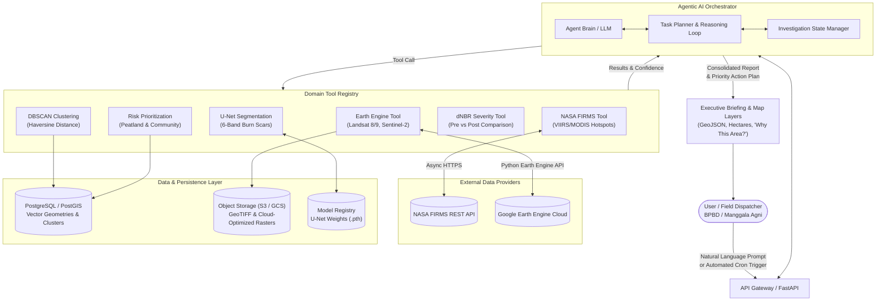

# SIGAP (Agen Karhutla) — High-Level System Architecture

> **Sistem Intelijen Geospasial & Agentic AI Pencegahan dan Penanggulangan Karhutla**  
> Autonomous Wildfire Investigation, Burn Scar Segmentation, and Action Prioritization.

---

## 1. System Overview

SIGAP is designed around an **Agentic AI core** that automates the complex multi-step workflow required to detect, analyze, and prioritize wildfires across Indonesia (particularly tropical peatland ecosystems in Kalimantan and Sumatra).

Rather than forcing human operators to manually query multiple satellite portals, manually calculate spectral indices, and vectorize raster files, SIGAP's Agentic Orchestrator autonomously plans and invokes specialized tools to produce validated, prioritized intelligence.



---

## 2. Component Descriptions

### 2.1 AI Command Center & Orchestrator
- **Role:** Natural language understanding and autonomous workflow execution.
- **Capabilities:**
  - Extracts spatial entities (regencies, provinces, coordinates) and temporal windows from user prompts.
  - Constructs multi-step execution graphs.
  - Dynamically adapts when encountering issues (e.g., if heavy cloud cover invalidates an optical satellite image, the agent expands the temporal window or attempts radar/composite fallbacks).
  - Generates clear natural language summaries in Indonesian/English explaining decision rationale.

### 2.2 Hotspot Ingestion & Clustering (`data/firms/` & `data/geospatial/clustering.py`)
- **NASA FIRMS Client:** Asynchronously queries VIIRS (375m) and MODIS (1km) sensors via REST API.
- **DBSCAN Clustering:**
  - Converts coordinates to radians and applies spherical haversine distance.
  - Clusters hotspots within a configurable radius (\(\varepsilon = 1.0 - 2.0\text{ km}\)).
  - Eliminates false positive noise (single isolated industrial flares, heat reflections).
  - Derives cluster statistics: geographic centroid, bounding box extent, active duration (hours), and cumulative Fire Radiative Power (MW).

### 2.3 Satellite Imagery Retrieval (`data/earth_engine/`)
- **Google Earth Engine Integration:**
  - Automatically bounds the Area of Interest (AOI) from cluster extents.
  - Queries Landsat 8/9 (`LANDSAT/LC09/C02/T1_L2`, `LANDSAT/LC08/C02/T1_L2`) and Sentinel-2 (`COPERNICUS/S2_SR_HARMONIZED`).
  - Fetches temporal pairs (pre-fire and post-fire imagery).
  - Performs scene-level and localized AOI cloud cover assessment via satellite `QA_PIXEL` masks.

### 2.4 Deep Learning Burn Scar Segmentation (`ml/unet/`)
- **U-Net Architecture:**
  - Standard encoder-decoder with skip connections preserving fine boundary perimeters.
  - 6 input spectral bands: Blue, Green, Red, Near-Infrared (NIR), Shortwave Infrared-1 (SWIR-1), Shortwave Infrared-2 (SWIR-2).
  - Output: High-resolution binary probability mask of burned areas.
- **Post-Processing:**
  - Converts binary raster mask to Shapely vector polygons.
  - Reprojects to equal-area projection (`EPSG:6933`) to calculate precise burned area in hectares.
  - Filters out small noise patches (\(< 0.5\text{ ha}\)).

### 2.5 dNBR & Burn Severity Analysis (`data/geospatial/dnbr.py`)
- Computes pixel-wise Normalized Burn Ratio:
  $$\text{NBR} = \frac{\text{NIR} - \text{SWIR}_2}{\text{NIR} + \text{SWIR}_2}$$
  $$\text{dNBR} = (\text{NBR}_{\text{pre}} - \text{NBR}_{\text{post}}) \times 1000$$
- Classifies damage using USGS FIREMON thresholds: Enhanced Regrowth, Unburned, Low, Moderate-Low, Moderate-High, and High Severity.
- Accounts for tropical peatland smoldering dynamics where canopy damage might lag subsurface peat consumption.

### 2.6 Multi-Criteria Risk Prioritization (`data/geospatial/priority.py`)
- Ranks candidate fire zones from 0 to 100 based on operational risk factors:
  - **Peatland status (25% weight):** Critical prevention against irreversible peat combustion and carbon release.
  - **Proximity to settlements (25% weight):** Protects human communities and air quality from toxic haze.
  - **Hotspot count (15% weight):** Magnitude of fire activity.
  - **Hotspot recurrence (15% weight):** Uncontained burning persisting across multiple days.
  - **Estimated burned area (10% weight):** Surface hectares impacted.
  - **Spectral burn severity (10% weight):** Destruction severity.
  - **Evidence Quality Multiplier:** Adjusts priority confidence based on cloud interference and sensor fidelity.
- Produces explanatory text (**"Why This Area? / Mengapa Wilayah Ini?"**) for decision-makers.

---

## 3. End-to-End Data Flow

```
[User Request / Automated Alert]
               │
               ▼
   1. Hotspot Ingestion (NASA FIRMS)
               │
               ▼
   2. Spatial Clustering (DBSCAN Haversine)
               │
               ▼
   3. GEE Imagery Search (Pre & Post Pairs)
               │
               ▼
      Cloud Cover Acceptable?
      ├── YES ──► 4. Run U-Net Segmentation & dNBR
      └── NO  ──► Expand date window / Flag for ground patrol
               │
               ▼
   5. Vectorize & Compute Burned Area (Hectares)
               │
               ▼
   6. Multi-Criteria Risk Scoring (Peatland, Proximity, Recurrence)
               │
               ▼
   7. Generate Prioritized Response Briefing & Map Layers
```

---

## 4. Deployment Considerations

### 4.1 Scalability & Cloud Infrastructure
- **API Layer:** FastAPI running in asynchronous worker processes (Uvicorn / Gunicorn) behind Nginx / Cloud Run.
- **Asynchronous Task Queue:** Heavy satellite fetching and model inference delegated to Celery or Temporal workers with Redis message broker.
- **GPU Acceleration:** U-Net inference optimized on NVIDIA GPUs (e.g. T4 or A10G) using PyTorch CUDA runtime, with batched patch processing.

### 4.2 Credentials & Security
- **NASA FIRMS MAP_KEY:** Managed via environment variables or cloud secret managers (GCP Secret Manager / AWS Secrets Manager).
- **Google Earth Engine Service Account:** Authenticated via JSON service account key with Earth Engine API enabled on Google Cloud.
- **Data Privacy:** Geospatial boundary queries contain non-sensitive coordinates, but field team dispatch locations and vulnerable settlement assets must be access-controlled via role-based access control (RBAC).

### 4.3 Resilience & Edge Scenarios
- **Cloud Cover Fallbacks:** Tropical regions (Sumatra, Kalimantan) often experience dense cloud cover. The system must support synthetic radar (Sentinel-1 SAR) or thermal-only confidence scoring when optical scenes are obscured.
- **Offline / Low-Bandwidth Mode:** Field patrol personnel (Manggala Agni) operating in remote forest areas receive lightweight GeoJSON vectors and condensed text summaries rather than heavy raw GeoTIFF rasters.
